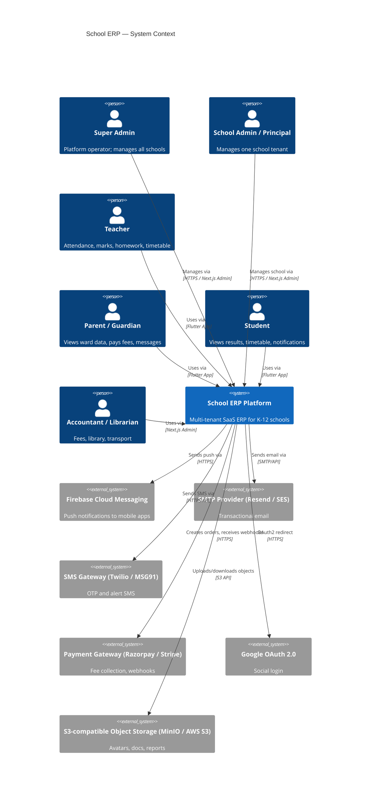
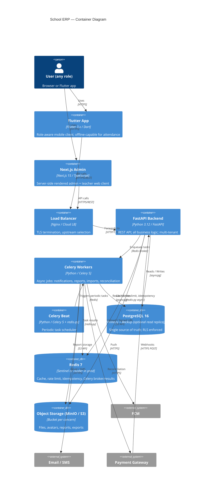
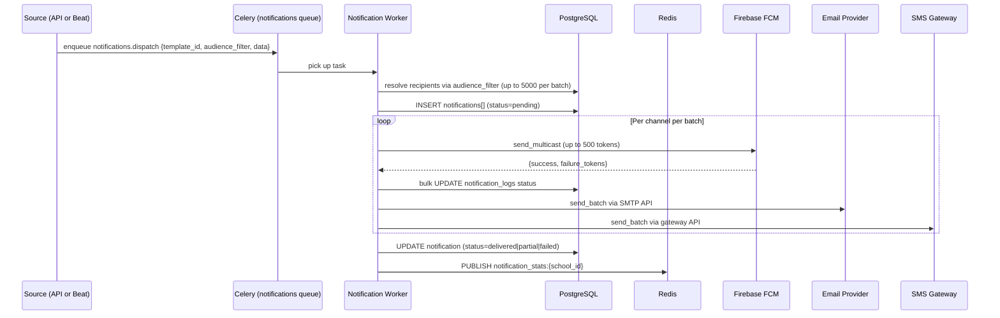
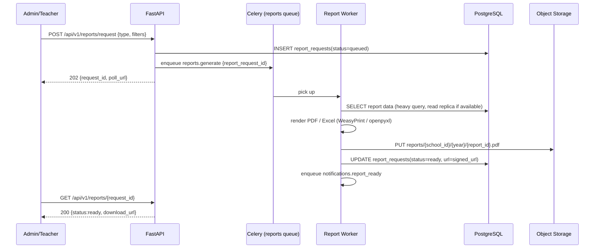

# 01 — System Architecture

> **Version:** 1.0 | **Phase:** 1 | **Status:** Approved (pending gate)

---

## Table of Contents

1. [Context Diagram](#1-context-diagram)
2. [Component Diagram](#2-component-diagram)
3. [Data-Flow Diagrams](#3-data-flow-diagrams)
4. [Backend Architecture](#4-backend-architecture)
5. [Mobile Architecture (Flutter)](#5-mobile-architecture-flutter)
6. [Admin Architecture (Next.js)](#6-admin-architecture-nextjs)
7. [Redis Architecture](#7-redis-architecture)
8. [Background Jobs (Celery)](#8-background-jobs-celery)
9. [Notification Architecture](#9-notification-architecture)
10. [Payment Architecture](#10-payment-architecture)
11. [File Storage Architecture](#11-file-storage-architecture)
12. [AI Service Abstraction](#12-ai-service-abstraction)
13. [Assumptions and Open Questions](#13-assumptions-and-open-questions)

---

## 1. Context Diagram



---

## 2. Component Diagram



---

## 3. Data-Flow Diagrams

### 3.1 Login Flow

```mermaid
sequenceDiagram
  participant C as Client (Flutter/Admin)
  participant LB as Load Balancer
  participant API as FastAPI
  participant DB as PostgreSQL
  participant R as Redis
  participant FCM as FCM (optional 2FA)

  C->>LB: POST /api/v1/auth/login {email, password}
  LB->>API: forward
  API->>R: rate-limit check (key: login:ip:{ip})
  R-->>API: allowed / throttled
  API->>DB: SELECT user WHERE email=? (citext, index)
  DB-->>API: user row (password_hash, status, 2fa_enabled)
  API->>API: bcrypt verify
  alt 2FA enabled
    API->>R: SET otp:{user_id} code TTL=300
    API->>FCM: (or SMS) send OTP
    API-->>C: 202 {step:"otp_required"}
    C->>API: POST /api/v1/auth/otp-verify {code}
    API->>R: GET + DEL otp:{user_id}
  end
  API->>DB: INSERT user_sessions; INSERT refresh_tokens
  API->>R: SET session:{jti} user_id TTL=access_ttl
  API-->>C: 200 {access_token, refresh_token, user, school}
```

### 3.2 Bulk Attendance Submit

```mermaid
sequenceDiagram
  participant T as Teacher (Flutter, offline-capable)
  participant API as FastAPI
  participant DB as PostgreSQL
  participant R as Redis
  participant Q as Celery (notifications queue)

  T->>API: POST /api/v1/attendance/sessions/{id}/records (idempotency-key header)
  API->>R: GET idempotency:{school_id}:{key}
  alt duplicate
    R-->>API: cached response
    API-->>T: 200 (replay)
  else first time
    API->>DB: BEGIN; upsert attendance_sessions; bulk upsert attendance_records; COMMIT
    DB-->>API: affected rows
    API->>R: SET idempotency:{school_id}:{key} response TTL=86400
    API->>Q: enqueue attendance.notify_parents task
    API-->>T: 201 {session_id, counts}
  end
```

### 3.3 Fee Payment with Webhook

```mermaid
sequenceDiagram
  participant P as Parent (Flutter)
  participant API as FastAPI
  participant DB as PostgreSQL
  participant GW as Razorpay
  participant W as Celery Worker

  P->>API: POST /api/v1/fees/orders {student_fee_id, installment_ids[]}
  API->>DB: BEGIN; INSERT fee_payments(status=pending); COMMIT
  API->>GW: create order API
  GW-->>API: {razorpay_order_id}
  API->>DB: UPDATE fee_payments SET gateway_order_id
  API-->>P: 200 {order_id, razorpay_key, amount}
  P->>GW: complete payment (SDK)
  GW->>API: POST /api/v1/webhooks/razorpay (HMAC-signed)
  API->>API: verify HMAC signature
  API->>DB: BEGIN; UPDATE fee_payments SET status=success; UPDATE student_fees; COMMIT
  API->>W: enqueue fees.generate_receipt task
  W->>DB: SELECT payment + student + school details
  W->>DB: INSERT file_metadata; UPDATE fee_receipts
  W->>W: enqueue notifications.send_receipt_email task
  API-->>GW: 200 OK
```

### 3.4 Notification Fan-Out



### 3.5 Report Generation



---

## 4. Backend Architecture

### 4.1 Layer Model

```
+---------------------------------------------+
|  HTTP Layer (FastAPI routers + middleware)   |  <- request/response, Pydantic v2 validation
+---------------------------------------------+
|  Service Layer (app/services/)              |  <- business rules, orchestration
+---------------------------------------------+
|  Repository Layer (app/repositories/)       |  <- data access; only SQLAlchemy here
+---------------------------------------------+
|  Domain Models (app/models/)                |  <- SQLAlchemy ORM; no business logic
+---------------------------------------------+
|  Infrastructure (core/database, core/cache) |  <- engine, sessions, Redis client
+---------------------------------------------+
```

**Dependency rules:**
- Routers -> Services -> Repositories -> Models
- Services may call peer Services via DI; never import cross-module Repositories directly
- Domain events emitted by Services, consumed by `workers/` via Celery tasks

### 4.2 Module Structure

```
app/
├── main.py
├── core/
│   ├── config.py        # pydantic-settings, env loading, fail-fast validation
│   ├── logging.py       # structlog JSON, request-id binding, sensitive-field redaction
│   ├── database.py      # async engine, session factory, tenant hook placeholder
│   ├── cache.py         # Redis async client, key builder helpers
│   ├── errors.py        # AppError hierarchy, exception handlers
│   ├── responses.py     # envelope models
│   ├── pagination.py    # offset + cursor pagination
│   └── security.py      # JWT, bcrypt
├── api/v1/
│   ├── router.py
│   ├── health.py
│   └── {module}/        # auth, students, attendance, fees, etc.
├── models/
│   ├── base.py          # DeclarativeBase, UUIDPrimaryKeyMixin, TimestampMixin, TenantMixin
│   └── {module}.py
├── schemas/             # Pydantic v2 I/O schemas
├── repositories/        # DB query layer per domain
├── services/            # Business logic per domain
├── permissions/         # Permission registry, decorators, row-scope checks
├── workers/
│   ├── celery_app.py    # queue definitions, Beat config
│   └── tasks/
├── middleware/
│   ├── request_id.py
│   ├── security_headers.py
│   ├── access_log.py
│   └── tenant.py        # Phase 2: SET LOCAL app.current_school_id
└── utils/
    ├── money.py         # integer paise arithmetic
    └── datetime_utils.py
```

### 4.3 Domain Events Table

| Emitting Module | Event | Consuming Module(s) |
|---|---|---|
| `auth` | `user.logged_in` | `audit` |
| `attendance` | `attendance.session_submitted` | `notifications`, `analytics` |
| `fees` | `payment.succeeded` | `notifications`, `receipts`, `analytics` |
| `fees` | `payment.failed` | `notifications` |
| `exams` | `results.published` | `notifications`, `report_cards` |
| `homework` | `homework.assigned` | `notifications` |
| `leave` | `leave.requested` | `notifications` |
| `library` | `book.overdue` | `notifications`, `fines` |
| `transport` | `vehicle.departed` | `notifications` |

---

## 5. Mobile Architecture (Flutter)

### 5.1 Feature-First Folder Structure

```
lib/
├── core/
│   ├── constants/           # app_constants.dart, api_constants.dart
│   ├── errors/              # Failure classes (NetworkFailure, ServerFailure, CacheFailure)
│   ├── usecases/            # UseCase<Type, Params> base class
│   └── extensions/
├── config/
│   ├── env.dart             # Environment with base URL per flavor
│   └── flavor_config.dart
├── routing/
│   ├── app_router.dart      # GoRouter instance
│   ├── route_guards.dart    # AuthGuard, RoleGuard, OnboardingGuard
│   └── route_names.dart
├── theme/
│   ├── app_theme.dart
│   ├── color_scheme.dart    # Material 3 ColorScheme seeds
│   ├── text_theme.dart
│   └── spacing.dart         # 4px grid spacing constants
├── network/
│   ├── dio_client.dart
│   ├── interceptors/
│   │   ├── auth_interceptor.dart
│   │   ├── request_id_interceptor.dart
│   │   ├── envelope_interceptor.dart
│   │   ├── retry_interceptor.dart
│   │   └── log_interceptor.dart
│   └── api_endpoints.dart
├── storage/
│   ├── secure_storage.dart  # flutter_secure_storage (tokens)
│   ├── preferences.dart     # shared_preferences (non-sensitive)
│   └── drift/
│       ├── app_database.dart
│       └── tables/
│           ├── attendance_table.dart
│           ├── sync_queue_table.dart
│           └── sync_state_table.dart
├── shared/
│   ├── widgets/
│   │   ├── skeleton_loader.dart
│   │   ├── empty_state.dart
│   │   ├── error_state.dart
│   │   └── offline_banner.dart
│   └── providers/
│       └── connectivity_provider.dart
├── l10n/
│   ├── app_en.arb
│   └── app_ta.arb
└── features/
    ├── startup/             # Phase 1
    ├── attendance/          # Phase 4
    ├── fees/                # Phase 6
    └── ...
```

### 5.2 Riverpod Provider Layering

```
UI Widget
  -> ref.watch(featureNotifierProvider)        [AsyncNotifierProvider]
       -> ref.watch(featureRepositoryProvider)  [Provider<FeatureRepository>]
            +-> ref.watch(dioClientProvider)    [Provider<Dio>]
            +-> ref.watch(appDatabaseProvider)  [Provider<AppDatabase>]  (offline)
```

### 5.3 Dio Interceptors

| Interceptor | Responsibility |
|---|---|
| `AuthInterceptor` | Inject Bearer; on 401 refresh silently; retry; on failure logout |
| `RequestIdInterceptor` | Generate UUID4 `X-Request-ID`; forward to logging |
| `EnvelopeInterceptor` | Unwrap `{data, meta, error}`; map errors to typed DioException |
| `RetryInterceptor` | Retry idempotent GETs up to 3x (1s, 2s, 4s backoff); never POST/PATCH |
| `LogInterceptor` | Log method, url, status, duration; redact Authorization, password, otp |

### 5.4 Role-Aware Navigation

| Role | Navigation Items |
|---|---|
| `super_admin` | Schools, System Settings, Analytics, Audit Logs |
| `school_admin` | Dashboard, Students, Staff, Classes, Fees, Reports, Settings |
| `teacher` | My Classes, Attendance, Homework, Exams, Timetable |
| `parent` | My Children, Fees, Messages, Notices |
| `student` | Dashboard, Timetable, Results, Library, Messages |
| `accountant` | Fee Collection, Receipts, Reports |
| `librarian` | Books, Issues, Fines |
| `transport_manager` | Routes, Buses, Tracking |

---

## 6. Admin Architecture (Next.js)

### 6.1 App Router Structure

```
app/
├── layout.tsx
├── (auth)/login/page.tsx
├── (super-admin)/
│   ├── layout.tsx              # role guard: super_admin only
│   ├── schools/page.tsx
│   ├── system-settings/page.tsx
│   └── audit-logs/page.tsx
├── (admin)/
│   ├── layout.tsx              # role guard: school_admin, accountant, librarian, transport
│   ├── dashboard/page.tsx
│   ├── students/page.tsx
│   ├── fees/page.tsx
│   └── reports/page.tsx
├── (teacher)/
│   ├── layout.tsx
│   └── attendance/page.tsx
└── system-status/page.tsx      # Phase 1: /ready display
```

### 6.2 Data Fetching

- TanStack Query v5: `useQuery`, `useMutation`, `useInfiniteQuery`
- Query keys: `[module, resource, id?, filters?]`
- Infinite scroll via cursor pagination
- Optimistic updates on mutations

### 6.3 API Client Pattern

```typescript
interface ApiResponse<T> {
  data: T;
  meta: { request_id: string; pagination?: PaginationMeta };
}
interface ApiError {
  code: string;     // e.g. "NOT_FOUND"
  message: string;
  details?: unknown;
  meta: { request_id: string };
}
```

- Auto-attach `X-Request-ID` (uuid4)
- On 401: refresh once, retry, then redirect `/login`
- Tables: TanStack Table v8 with URL-synced filters via `nuqs`

---

## 7. Redis Architecture

### 7.1 Key Naming Convention

| Pattern | Example | TTL |
|---|---|---|
| `session:{jti}` | `session:uuid4` | 15 min |
| `refresh:{family_id}` | `refresh:uuid4` | 30d |
| `otp:{user_id}` | `otp:u_123` | 5 min |
| `rl:login:ip:{ip}` | `rl:login:ip:1.2.3.4` | 1 min window |
| `rl:api:{school_id}:{user_id}` | `rl:api:s_1:u_42` | 1 min |
| `cache:{school_id}:{resource}:{id}` | `cache:s_1:student:u_5` | 5 min |
| `cache:{school_id}:dashboard` | `cache:s_1:dashboard` | 2 min |
| `idem:{school_id}:{key}` | `idem:s_1:abc123` | 24h |
| `sync:beat:lock:{task}` | `sync:beat:lock:fee_reminders` | task period |

### 7.2 Cache Invalidation Table

| Cache Key | Invalidated When | Strategy |
|---|---|---|
| `cache:{school_id}:student:{id}` | Student updated | Delete on write |
| `cache:{school_id}:dashboard` | Dashboard-affecting write | Delete on write |
| `cache:{school_id}:class_list` | Class/section added/renamed | Delete on write |
| `cache:{school_id}:fee_structure` | Fee structure updated | Delete on write |
| `cache:{school_id}:timetable:{class_id}` | Timetable published | Delete on write |
| `session:{jti}` | Logout / password change | Delete + blocklist |

### 7.3 Redis DB Index Allocation

| Index | Use |
|---|---|
| 0 | Application cache, rate limits, idempotency, sessions |
| 1 | Celery broker |
| 2 | Celery result backend |
| 3 | Pub/Sub (real-time notifications) |

---

## 8. Background Jobs (Celery)

### 8.1 Queue Definitions

| Queue | Workers | Purpose |
|---|---|---|
| `critical` | Dedicated | OTP delivery, payment webhook handling |
| `default` | Shared | General tasks, cache warming |
| `notifications` | Shared | Fan-out push/email/SMS |
| `reports` | Dedicated | PDF/Excel generation (CPU-bound) |
| `imports` | Dedicated | Bulk CSV import, data migrations |

### 8.2 Retry Policy

```python
# Default
autoretry_for = (Exception,)
max_retries = 3
retry_backoff = True        # exponential: 2^n * 1s
retry_backoff_max = 600
retry_jitter = True

# Critical (OTP, payment)
max_retries = 5
retry_backoff_max = 60

# Reports
max_retries = 2
acks_late = True
reject_on_worker_lost = True
```

### 8.3 Beat Schedule

| Task | Schedule | Queue |
|---|---|---|
| `fees.send_reminders` | Daily 08:00 IST | `notifications` |
| `fees.reconcile_pending` | Every 30 min | `critical` |
| `fees.auto_apply_fines` | Daily 00:00 IST | `default` |
| `library.check_overdue` | Daily 07:00 IST | `notifications` |
| `notifications.retry_failed` | Every 15 min | `notifications` |
| `analytics.daily_rollup` | Daily 01:00 IST | `default` |
| `analytics.weekly_report` | Monday 06:00 IST | `reports` |
| `reports.cleanup_expired` | Daily 03:00 IST | `default` |
| `auth.cleanup_expired_tokens` | Hourly | `default` |
| `dlq_monitor.check` | Hourly | `default` |

---

## 9. Notification Architecture

### 9.1 Template System

- Templates in `notification_templates` table (per school, per locale)
- Variables: `{{student_name}}`, `{{amount}}`, `{{due_date}}`, etc.
- Channels: `push`, `email`, `sms`, `in_app`

### 9.2 Priority Routing

| Priority | Queue | Max Retries | Audience Limit |
|---|---|---|---|
| `critical` | `critical` | 5 | 1 (individual) |
| `high` | `notifications` | 3 | 500 |
| `normal` | `notifications` | 3 | 5000 |
| `low` | `notifications` | 1 | unlimited (chunked 500) |

### 9.3 Delivery Status

`notification_logs`: `pending -> sent -> delivered -> failed -> retry_exhausted`

FCM: token failures trigger token cleanup in DB. Large audiences chunked to separate Celery tasks.

---

## 10. Payment Architecture

### 10.1 Provider Abstraction

```python
class PaymentProvider(Protocol):
    async def create_order(self, params: CreateOrderParams) -> OrderResult: ...
    async def verify_webhook(self, headers: dict, body: bytes) -> WebhookEvent: ...
    async def fetch_payment(self, gateway_payment_id: str) -> PaymentDetails: ...
    async def initiate_refund(self, params: RefundParams) -> RefundResult: ...
```

Active provider selected via `school_settings.payment_provider`. Default: `RazorpayProvider`.

### 10.2 Amount Handling

All amounts stored as `INTEGER` paise (1/100 INR). Never `FLOAT`. Display-layer only divides by 100.

### 10.3 Webhook Security

```
HMAC-SHA256(secret, "{order_id}|{payment_id}") == received_signature
```

Webhook endpoint is unauthenticated (no JWT), HMAC-only. Must return 200 within 5s; processing dispatched to Celery.

---

## 11. File Storage Architecture

### 11.1 Bucket Layout

```
school-erp-{env}/
├── avatars/{school_id}/{user_id}.{ext}
├── documents/{school_id}/{student_id}/{doc_type}/{file_id}.{ext}
├── homework/{school_id}/{homework_id}/submissions/{submission_id}/{file_id}.{ext}
├── receipts/{school_id}/{academic_year}/{receipt_id}.pdf
├── reports/{school_id}/{academic_year}/{report_id}.{ext}
├── imports/{school_id}/{import_batch_id}/{filename}
├── templates/{school_id}/letterhead.{ext}
└── system/defaults/
```

### 11.2 Signed URL TTLs

| Purpose | Method | TTL |
|---|---|---|
| Avatar | GET | 7 days |
| Receipt | GET | 7 days |
| Report | GET | 1 day |
| Homework submission | GET | 1 hour |
| Student document | GET | 1 hour |
| Upload (pre-signed PUT) | PUT | 15 min |

### 11.3 Retention Policy

| Category | Retention |
|---|---|
| Receipts | 7 years |
| Report cards | 10 years |
| Homework submissions | Academic year + 1 year |
| Temp uploads | 24 hours (lifecycle rule) |

---

## 12. AI Service Abstraction

```python
class AIService(Protocol):
    async def generate_report_comment(self, student_data: dict) -> str: ...
    async def predict_fee_default_risk(self, student_id: UUID) -> float: ...
    async def detect_attendance_anomaly(self, session_data: dict) -> list[str]: ...

class NoOpAIService:
    """Default: graceful degradation when AI not configured."""
    async def generate_report_comment(self, student_data: dict) -> str: return ""
    async def predict_fee_default_risk(self, student_id: UUID) -> float: return 0.0
    async def detect_attendance_anomaly(self, session_data: dict) -> list[str]: return []
```

- Toggled via `ENABLE_AI_FEATURES=false` in config
- AI tasks receive scoped read-only token for requesting school only; no cross-tenant data
- Always async, non-blocking, wrapped in try/except for graceful degradation

---

## 13. Assumptions and Open Questions

### Assumptions

1. Deployment target: self-hosted VPS or managed cloud; not serverless.
2. Primary payment gateway: Razorpay (Indian market).
3. SMS gateway: MSG91 as default.
4. Languages: English + Tamil in Phase 1; additional per school in Phase 5.
5. Read replica is optional; session factory falls back to primary if unconfigured.
6. Flutter targets Android and iOS only; web not planned.
7. Single-tenant sizing: ~1,500 students; 100-school aggregate: ~150,000 students.
8. Single active academic year per school; year-end rollover is Phase 10.
9. FCM free tier sufficient for notification volume at 100 schools.
10. ClamAV scanning deferred to Phase 7; Phase 1 uses content-type + size validation only.

### Open Questions

1. **Multi-currency:** INR (paise) only, or support USD/GBP for international schools?
2. **Offline scope:** Is offline attendance the only Phase 1 offline feature, or also homework/timetable?
3. **Real-time notifications:** SSE (simpler) or WebSocket (bidirectional) for in-app channel?
4. **Google Workspace SSO:** Any schools need Google Classroom integration in early phases?
5. **Curriculum types:** Multiple curriculum types (CBSE, State Board, IB) per school from Phase 1, or configurable grading system is sufficient?
