# 02 — Database Design

> **Version:** 1.0 | **Phase:** 1 | **Status:** Approved (pending gate)

---

## Table of Contents

1. [ER Diagram](#1-er-diagram)
2. [Table Definitions](#2-table-definitions)
3. [Index Strategy](#3-index-strategy)
4. [Row Counts and Partitioning](#4-row-counts-and-partitioning)
5. [Row-Level Security](#5-row-level-security)
6. [Migration Strategy](#6-migration-strategy)
7. [Assumptions and Open Questions](#7-assumptions-and-open-questions)

---

## 1. ER Diagram

```mermaid
erDiagram
  schools ||--o{ users : "employs/enrolls"
  schools ||--o{ school_settings : "has"
  schools ||--o{ academic_years : "has"
  schools ||--o{ students : "enrolls"
  schools ||--o{ classes : "has"
  schools ||--o{ fee_categories : "has"
  schools ||--o{ notifications : "sends"

  users ||--o{ user_sessions : "has"
  users ||--o{ refresh_tokens : "has"
  users ||--o{ user_roles : "assigned"
  roles ||--o{ role_permissions : "has"
  roles ||--o{ user_roles : "assigned to"
  permissions ||--o{ role_permissions : "granted by"

  students ||--o{ student_guardians : "linked to"
  parents ||--o{ student_guardians : "links to"
  students ||--o{ student_enrollments : "enrolled via"
  classes ||--o{ sections : "has"
  sections ||--o{ student_enrollments : "contains"
  teachers ||--o{ teacher_subjects : "assigned"
  subjects ||--o{ teacher_subjects : "assigned"
  classes ||--o{ class_subjects : "covers"
  subjects ||--o{ class_subjects : "covered by"

  sections ||--o{ attendance_sessions : "has"
  attendance_sessions ||--o{ attendance_records : "contains"
  attendance_records ||--o{ attendance_corrections : "corrected by"

  classes ||--o{ timetables : "has"
  timetables ||--o{ timetable_periods : "defines"
  timetable_periods ||--o{ timetable_entries : "contains"

  sections ||--o{ homework : "assigned to"
  homework ||--o{ homework_submissions : "submitted via"

  schools ||--o{ exams : "administers"
  exams ||--o{ exam_subjects : "covers"
  exams ||--o{ exam_schedules : "has"
  exam_subjects ||--o{ marks : "contains"
  students ||--o{ marks : "receives"
  students ||--o{ report_cards : "has"

  schools ||--o{ fee_structures : "defines"
  fee_structures ||--o{ fee_installments : "has"
  students ||--o{ student_fees : "owes"
  student_fees ||--o{ fee_payments : "paid via"
  fee_payments ||--o{ fee_receipts : "generates"
  fee_payments ||--o{ refunds : "may have"

  users ||--o{ leave_requests : "submits"

  schools ||--o{ library_books : "owns"
  library_books ||--o{ library_copies : "has"
  library_copies ||--o{ book_issues : "issued via"
  book_issues ||--o{ library_fines : "generates"

  schools ||--o{ buses : "owns"
  buses ||--o{ drivers : "assigned"
  schools ||--o{ transport_routes : "has"
  transport_routes ||--o{ transport_stops : "has"
  students ||--o{ student_transport : "enrolled in"

  users ||--o{ notifications : "receives"
  notification_templates ||--o{ notifications : "uses"
  notifications ||--o{ notification_logs : "tracked by"
  users ||--o{ conversations : "participates in"
  conversations ||--o{ messages : "contains"

  schools ||--o{ documents : "stores"
  file_metadata ||--o{ documents : "describes"
  users ||--o{ audit_logs : "generates"
```



---

## 2. Table Definitions

Legend: `T` = tenant-scoped (`school_id`), `SD` = soft-delete, `AO` = append-only

---

### 2.1 Platform and Tenancy

#### `schools` [T:root, SD]

```sql
CREATE TABLE schools (
  id            UUID        PRIMARY KEY DEFAULT gen_random_uuid(),
  name          VARCHAR(200) NOT NULL,
  slug          VARCHAR(100) NOT NULL UNIQUE,            -- URL-safe identifier
  address       TEXT,
  city          VARCHAR(100),
  state         VARCHAR(100),
  pin_code      VARCHAR(10),
  country       CHAR(2)     NOT NULL DEFAULT 'IN',
  phone         VARCHAR(20),
  email         CITEXT      NOT NULL UNIQUE,
  logo_file_id  UUID        REFERENCES file_metadata(id),
  status        VARCHAR(20) NOT NULL DEFAULT 'active'
                CHECK (status IN ('active','suspended','trial','archived')),
  plan          VARCHAR(50) NOT NULL DEFAULT 'basic',
  timezone      VARCHAR(50) NOT NULL DEFAULT 'Asia/Kolkata',
  locale        VARCHAR(10) NOT NULL DEFAULT 'en',
  created_at    TIMESTAMPTZ NOT NULL DEFAULT now(),
  updated_at    TIMESTAMPTZ NOT NULL DEFAULT now(),
  deleted_at    TIMESTAMPTZ
);

CREATE INDEX idx_schools_slug    ON schools(slug);
CREATE INDEX idx_schools_status  ON schools(status) WHERE deleted_at IS NULL;
```

#### `school_settings` [T]

```sql
CREATE TABLE school_settings (
  id                    UUID        PRIMARY KEY DEFAULT gen_random_uuid(),
  school_id             UUID        NOT NULL UNIQUE REFERENCES schools(id) ON DELETE CASCADE,
  academic_year_start_month SMALLINT NOT NULL DEFAULT 6 CHECK (academic_year_start_month BETWEEN 1 AND 12),
  working_days          JSONB       NOT NULL DEFAULT '["Mon","Tue","Wed","Thu","Fri"]',
  payment_provider      VARCHAR(30) NOT NULL DEFAULT 'razorpay'
                        CHECK (payment_provider IN ('razorpay','stripe','none')),
  razorpay_key_id       TEXT,                           -- encrypted at rest
  razorpay_key_secret   TEXT,                           -- encrypted at rest
  stripe_publishable_key TEXT,
  stripe_secret_key     TEXT,
  fcm_server_key        TEXT,
  smtp_host             VARCHAR(200),
  smtp_port             SMALLINT,
  smtp_user             TEXT,
  smtp_password         TEXT,                           -- encrypted at rest
  sms_provider          VARCHAR(30) DEFAULT 'msg91',
  sms_api_key           TEXT,                           -- encrypted at rest
  late_fee_enabled      BOOLEAN     NOT NULL DEFAULT false,
  late_fee_percent      NUMERIC(5,2),
  attendance_lock_days  SMALLINT    NOT NULL DEFAULT 3,
  created_at            TIMESTAMPTZ NOT NULL DEFAULT now(),
  updated_at            TIMESTAMPTZ NOT NULL DEFAULT now()
);
```

#### `system_settings` (platform-wide, not tenant-scoped)

```sql
CREATE TABLE system_settings (
  key         VARCHAR(100) PRIMARY KEY,
  value       JSONB        NOT NULL,
  description TEXT,
  updated_at  TIMESTAMPTZ  NOT NULL DEFAULT now(),
  updated_by  UUID         REFERENCES users(id)
);
```

#### `academic_years` [T]

```sql
CREATE TABLE academic_years (
  id          UUID        PRIMARY KEY DEFAULT gen_random_uuid(),
  school_id   UUID        NOT NULL REFERENCES schools(id) ON DELETE CASCADE,
  name        VARCHAR(50) NOT NULL,           -- e.g. "2025-26"
  start_date  DATE        NOT NULL,
  end_date    DATE        NOT NULL,
  is_current  BOOLEAN     NOT NULL DEFAULT false,
  created_at  TIMESTAMPTZ NOT NULL DEFAULT now(),
  updated_at  TIMESTAMPTZ NOT NULL DEFAULT now(),
  UNIQUE (school_id, name),
  CHECK (end_date > start_date)
);

CREATE UNIQUE INDEX idx_academic_years_current
  ON academic_years(school_id) WHERE is_current = true;
CREATE INDEX idx_academic_years_school ON academic_years(school_id);
```

---

### 2.2 Identity

#### `users` [T, SD]

```sql
CREATE TABLE users (
  id              UUID        PRIMARY KEY DEFAULT gen_random_uuid(),
  school_id       UUID        REFERENCES schools(id) ON DELETE CASCADE,
                              -- NULL for super_admin (platform-level)
  email           CITEXT      UNIQUE,
  phone           VARCHAR(20),
  phone_verified  BOOLEAN     NOT NULL DEFAULT false,
  email_verified  BOOLEAN     NOT NULL DEFAULT false,
  password_hash   TEXT,
  first_name      VARCHAR(100) NOT NULL,
  last_name       VARCHAR(100) NOT NULL,
  display_name    VARCHAR(200) GENERATED ALWAYS AS (first_name || ' ' || last_name) STORED,
  avatar_file_id  UUID        REFERENCES file_metadata(id),
  status          VARCHAR(20) NOT NULL DEFAULT 'active'
                  CHECK (status IN ('active','inactive','suspended')),
  locale          VARCHAR(10) NOT NULL DEFAULT 'en',
  google_sub      VARCHAR(200) UNIQUE,  -- Google OAuth subject
  last_login_at   TIMESTAMPTZ,
  created_at      TIMESTAMPTZ NOT NULL DEFAULT now(),
  updated_at      TIMESTAMPTZ NOT NULL DEFAULT now(),
  deleted_at      TIMESTAMPTZ,
  CONSTRAINT users_email_or_phone CHECK (email IS NOT NULL OR phone IS NOT NULL)
);

CREATE INDEX idx_users_school       ON users(school_id) WHERE deleted_at IS NULL;
CREATE INDEX idx_users_email        ON users(email);
CREATE INDEX idx_users_phone        ON users(phone);
CREATE INDEX idx_users_google_sub   ON users(google_sub);
```

#### `roles`

```sql
CREATE TABLE roles (
  id          UUID        PRIMARY KEY DEFAULT gen_random_uuid(),
  name        VARCHAR(50) NOT NULL UNIQUE,
  description TEXT,
  is_system   BOOLEAN     NOT NULL DEFAULT true,  -- false = custom role (Phase 5+)
  created_at  TIMESTAMPTZ NOT NULL DEFAULT now()
);
-- Seeded: super_admin, school_admin, teacher, parent, student, accountant, librarian,
--         transport_manager, receptionist
```

#### `permissions`

```sql
CREATE TABLE permissions (
  id          UUID        PRIMARY KEY DEFAULT gen_random_uuid(),
  name        VARCHAR(100) NOT NULL UNIQUE,  -- e.g. "attendance.submit"
  module      VARCHAR(50)  NOT NULL,         -- e.g. "attendance"
  description TEXT,
  created_at  TIMESTAMPTZ NOT NULL DEFAULT now()
);

CREATE INDEX idx_permissions_module ON permissions(module);
```

#### `role_permissions`

```sql
CREATE TABLE role_permissions (
  role_id       UUID NOT NULL REFERENCES roles(id) ON DELETE CASCADE,
  permission_id UUID NOT NULL REFERENCES permissions(id) ON DELETE CASCADE,
  PRIMARY KEY (role_id, permission_id)
);
```

#### `user_roles` [T]

```sql
CREATE TABLE user_roles (
  id          UUID        PRIMARY KEY DEFAULT gen_random_uuid(),
  user_id     UUID        NOT NULL REFERENCES users(id) ON DELETE CASCADE,
  role_id     UUID        NOT NULL REFERENCES roles(id),
  school_id   UUID        REFERENCES schools(id) ON DELETE CASCADE,
  granted_by  UUID        REFERENCES users(id),
  granted_at  TIMESTAMPTZ NOT NULL DEFAULT now(),
  UNIQUE (user_id, role_id, school_id)
);

CREATE INDEX idx_user_roles_user   ON user_roles(user_id);
CREATE INDEX idx_user_roles_school ON user_roles(school_id);
```

#### `user_sessions` [T, AO]

```sql
CREATE TABLE user_sessions (
  id             UUID        PRIMARY KEY DEFAULT gen_random_uuid(),
  user_id        UUID        NOT NULL REFERENCES users(id) ON DELETE CASCADE,
  school_id      UUID        REFERENCES schools(id) ON DELETE CASCADE,
  jti            UUID        NOT NULL UNIQUE,   -- JWT ID (access token)
  device_name    VARCHAR(200),
  device_type    VARCHAR(50),                   -- 'mobile' | 'web' | 'desktop'
  ip_address     INET,
  user_agent     TEXT,
  created_at     TIMESTAMPTZ NOT NULL DEFAULT now(),
  last_active_at TIMESTAMPTZ NOT NULL DEFAULT now(),
  expires_at     TIMESTAMPTZ NOT NULL,
  revoked_at     TIMESTAMPTZ
);

CREATE INDEX idx_user_sessions_user    ON user_sessions(user_id);
CREATE INDEX idx_user_sessions_jti     ON user_sessions(jti);
CREATE INDEX idx_user_sessions_active  ON user_sessions(user_id) WHERE revoked_at IS NULL;
```

#### `refresh_tokens` [T, AO]

```sql
CREATE TABLE refresh_tokens (
  id          UUID        PRIMARY KEY DEFAULT gen_random_uuid(),
  session_id  UUID        NOT NULL REFERENCES user_sessions(id) ON DELETE CASCADE,
  user_id     UUID        NOT NULL REFERENCES users(id) ON DELETE CASCADE,
  family_id   UUID        NOT NULL,            -- rotated family; reuse detection key
  token_hash  TEXT        NOT NULL UNIQUE,     -- SHA-256 of raw token
  created_at  TIMESTAMPTZ NOT NULL DEFAULT now(),
  expires_at  TIMESTAMPTZ NOT NULL,
  used_at     TIMESTAMPTZ,
  revoked_at  TIMESTAMPTZ
);

CREATE INDEX idx_refresh_tokens_family ON refresh_tokens(family_id);
CREATE INDEX idx_refresh_tokens_user   ON refresh_tokens(user_id);
```

#### `password_reset_tokens` [AO]

```sql
CREATE TABLE password_reset_tokens (
  id          UUID        PRIMARY KEY DEFAULT gen_random_uuid(),
  user_id     UUID        NOT NULL REFERENCES users(id) ON DELETE CASCADE,
  token_hash  TEXT        NOT NULL UNIQUE,
  created_at  TIMESTAMPTZ NOT NULL DEFAULT now(),
  expires_at  TIMESTAMPTZ NOT NULL,
  used_at     TIMESTAMPTZ
);
```

#### `otp_codes` [AO]

```sql
CREATE TABLE otp_codes (
  id          UUID        PRIMARY KEY DEFAULT gen_random_uuid(),
  user_id     UUID        NOT NULL REFERENCES users(id) ON DELETE CASCADE,
  purpose     VARCHAR(30) NOT NULL CHECK (purpose IN ('phone_verify','email_verify','login_2fa','password_reset')),
  code_hash   TEXT        NOT NULL,
  created_at  TIMESTAMPTZ NOT NULL DEFAULT now(),
  expires_at  TIMESTAMPTZ NOT NULL,
  verified_at TIMESTAMPTZ,
  attempts    SMALLINT    NOT NULL DEFAULT 0 CHECK (attempts <= 5)
);

CREATE INDEX idx_otp_codes_user ON otp_codes(user_id, purpose) WHERE verified_at IS NULL;
```

#### `two_factor_secrets`

```sql
CREATE TABLE two_factor_secrets (
  id          UUID        PRIMARY KEY DEFAULT gen_random_uuid(),
  user_id     UUID        NOT NULL UNIQUE REFERENCES users(id) ON DELETE CASCADE,
  secret      TEXT        NOT NULL,  -- TOTP secret, AES-256 encrypted
  backup_codes JSONB      NOT NULL DEFAULT '[]',  -- hashed backup codes
  enabled_at  TIMESTAMPTZ,
  created_at  TIMESTAMPTZ NOT NULL DEFAULT now()
);
```

---

### 2.3 People

#### `students` [T, SD]

```sql
CREATE TABLE students (
  id              UUID        PRIMARY KEY DEFAULT gen_random_uuid(),
  school_id       UUID        NOT NULL REFERENCES schools(id) ON DELETE CASCADE,
  user_id         UUID        NOT NULL UNIQUE REFERENCES users(id),
  admission_number VARCHAR(50) NOT NULL,
  admission_date  DATE        NOT NULL,
  date_of_birth   DATE        NOT NULL,
  gender          VARCHAR(10) NOT NULL CHECK (gender IN ('male','female','other')),
  blood_group     VARCHAR(5),
  aadhaar_hash    TEXT,          -- SHA-256 of Aadhaar; stored for dedup only
  religion        VARCHAR(50),
  caste_category  VARCHAR(20),   -- GEN, OBC, SC, ST
  nationality     CHAR(2)     NOT NULL DEFAULT 'IN',
  emergency_contact_name  VARCHAR(200),
  emergency_contact_phone VARCHAR(20),
  medical_notes   TEXT,          -- sensitive; RLS read restriction
  created_at      TIMESTAMPTZ NOT NULL DEFAULT now(),
  updated_at      TIMESTAMPTZ NOT NULL DEFAULT now(),
  deleted_at      TIMESTAMPTZ,
  UNIQUE (school_id, admission_number)
);

CREATE INDEX idx_students_school    ON students(school_id) WHERE deleted_at IS NULL;
CREATE INDEX idx_students_user      ON students(user_id);
CREATE INDEX idx_students_dob       ON students(date_of_birth);
CREATE INDEX idx_students_name_trgm ON users USING gin(display_name gin_trgm_ops);
-- Note: name search is on users table joined via user_id
```

#### `parents` [T, SD]

```sql
CREATE TABLE parents (
  id          UUID        PRIMARY KEY DEFAULT gen_random_uuid(),
  school_id   UUID        NOT NULL REFERENCES schools(id) ON DELETE CASCADE,
  user_id     UUID        NOT NULL UNIQUE REFERENCES users(id),
  occupation  VARCHAR(100),
  annual_income_range VARCHAR(30),
  created_at  TIMESTAMPTZ NOT NULL DEFAULT now(),
  updated_at  TIMESTAMPTZ NOT NULL DEFAULT now(),
  deleted_at  TIMESTAMPTZ
);

CREATE INDEX idx_parents_school ON parents(school_id) WHERE deleted_at IS NULL;
```

#### `guardians`

```sql
CREATE TABLE guardians (
  id              UUID        PRIMARY KEY DEFAULT gen_random_uuid(),
  school_id       UUID        NOT NULL REFERENCES schools(id) ON DELETE CASCADE,
  name            VARCHAR(200) NOT NULL,
  relationship    VARCHAR(50) NOT NULL,
  phone           VARCHAR(20),
  email           CITEXT,
  is_emergency    BOOLEAN     NOT NULL DEFAULT false,
  created_at      TIMESTAMPTZ NOT NULL DEFAULT now(),
  updated_at      TIMESTAMPTZ NOT NULL DEFAULT now()
);
```

#### `student_guardians` [T]

```sql
CREATE TABLE student_guardians (
  id              UUID        PRIMARY KEY DEFAULT gen_random_uuid(),
  student_id      UUID        NOT NULL REFERENCES students(id) ON DELETE CASCADE,
  guardian_id     UUID        REFERENCES guardians(id),
  parent_id       UUID        REFERENCES parents(id),
  relationship    VARCHAR(50) NOT NULL,
  is_primary      BOOLEAN     NOT NULL DEFAULT false,
  can_pickup      BOOLEAN     NOT NULL DEFAULT true,
  created_at      TIMESTAMPTZ NOT NULL DEFAULT now(),
  CHECK (guardian_id IS NOT NULL OR parent_id IS NOT NULL)
);

CREATE UNIQUE INDEX idx_sg_primary ON student_guardians(student_id) WHERE is_primary = true;
CREATE INDEX idx_sg_student ON student_guardians(student_id);
CREATE INDEX idx_sg_parent  ON student_guardians(parent_id);
```

#### `teachers` [T, SD]

```sql
CREATE TABLE teachers (
  id              UUID        PRIMARY KEY DEFAULT gen_random_uuid(),
  school_id       UUID        NOT NULL REFERENCES schools(id) ON DELETE CASCADE,
  user_id         UUID        NOT NULL UNIQUE REFERENCES users(id),
  employee_code   VARCHAR(50),
  designation     VARCHAR(100),
  qualification   TEXT,
  joining_date    DATE,
  created_at      TIMESTAMPTZ NOT NULL DEFAULT now(),
  updated_at      TIMESTAMPTZ NOT NULL DEFAULT now(),
  deleted_at      TIMESTAMPTZ,
  UNIQUE (school_id, employee_code)
);

CREATE INDEX idx_teachers_school ON teachers(school_id) WHERE deleted_at IS NULL;
```

#### `staff` [T, SD]

```sql
CREATE TABLE staff (
  id            UUID        PRIMARY KEY DEFAULT gen_random_uuid(),
  school_id     UUID        NOT NULL REFERENCES schools(id) ON DELETE CASCADE,
  user_id       UUID        NOT NULL UNIQUE REFERENCES users(id),
  employee_code VARCHAR(50),
  department    VARCHAR(100),
  designation   VARCHAR(100),
  joining_date  DATE,
  created_at    TIMESTAMPTZ NOT NULL DEFAULT now(),
  updated_at    TIMESTAMPTZ NOT NULL DEFAULT now(),
  deleted_at    TIMESTAMPTZ,
  UNIQUE (school_id, employee_code)
);

CREATE INDEX idx_staff_school ON staff(school_id) WHERE deleted_at IS NULL;
```

#### `student_enrollments` [T]

```sql
CREATE TABLE student_enrollments (
  id              UUID        PRIMARY KEY DEFAULT gen_random_uuid(),
  school_id       UUID        NOT NULL REFERENCES schools(id) ON DELETE CASCADE,
  student_id      UUID        NOT NULL REFERENCES students(id) ON DELETE CASCADE,
  academic_year_id UUID       NOT NULL REFERENCES academic_years(id),
  section_id      UUID        NOT NULL REFERENCES sections(id),
  roll_number     VARCHAR(20),
  status          VARCHAR(20) NOT NULL DEFAULT 'active'
                  CHECK (status IN ('active','transferred','withdrawn','graduated')),
  enrolled_at     TIMESTAMPTZ NOT NULL DEFAULT now(),
  left_at         TIMESTAMPTZ,
  UNIQUE (student_id, academic_year_id)
);

CREATE INDEX idx_enrollments_section   ON student_enrollments(section_id, academic_year_id) WHERE status='active';
CREATE INDEX idx_enrollments_student   ON student_enrollments(student_id);
CREATE INDEX idx_enrollments_year      ON student_enrollments(academic_year_id);
```

---

### 2.4 Academic

#### `classes` [T]

```sql
CREATE TABLE classes (
  id          UUID        PRIMARY KEY DEFAULT gen_random_uuid(),
  school_id   UUID        NOT NULL REFERENCES schools(id) ON DELETE CASCADE,
  name        VARCHAR(50) NOT NULL,   -- e.g. "Grade 1", "Class 10"
  level       SMALLINT    NOT NULL,   -- numeric sort order
  created_at  TIMESTAMPTZ NOT NULL DEFAULT now(),
  updated_at  TIMESTAMPTZ NOT NULL DEFAULT now(),
  UNIQUE (school_id, name)
);

CREATE INDEX idx_classes_school ON classes(school_id);
```

#### `sections` [T]

```sql
CREATE TABLE sections (
  id            UUID        PRIMARY KEY DEFAULT gen_random_uuid(),
  school_id     UUID        NOT NULL REFERENCES schools(id) ON DELETE CASCADE,
  class_id      UUID        NOT NULL REFERENCES classes(id) ON DELETE CASCADE,
  name          VARCHAR(10) NOT NULL,  -- e.g. "A", "B"
  capacity      SMALLINT    NOT NULL DEFAULT 40,
  room_id       UUID        REFERENCES rooms(id),
  class_teacher_id UUID     REFERENCES teachers(id),
  created_at    TIMESTAMPTZ NOT NULL DEFAULT now(),
  updated_at    TIMESTAMPTZ NOT NULL DEFAULT now(),
  UNIQUE (class_id, name)
);

CREATE INDEX idx_sections_class  ON sections(class_id);
CREATE INDEX idx_sections_school ON sections(school_id);
```

#### `subjects` [T]

```sql
CREATE TABLE subjects (
  id          UUID        PRIMARY KEY DEFAULT gen_random_uuid(),
  school_id   UUID        NOT NULL REFERENCES schools(id) ON DELETE CASCADE,
  name        VARCHAR(100) NOT NULL,
  code        VARCHAR(20),
  subject_type VARCHAR(20) NOT NULL DEFAULT 'theory'
              CHECK (subject_type IN ('theory','practical','language','elective')),
  created_at  TIMESTAMPTZ NOT NULL DEFAULT now(),
  updated_at  TIMESTAMPTZ NOT NULL DEFAULT now(),
  UNIQUE (school_id, code)
);

CREATE INDEX idx_subjects_school ON subjects(school_id);
```

#### `class_subjects` [T]

```sql
CREATE TABLE class_subjects (
  id              UUID    PRIMARY KEY DEFAULT gen_random_uuid(),
  school_id       UUID    NOT NULL REFERENCES schools(id) ON DELETE CASCADE,
  class_id        UUID    NOT NULL REFERENCES classes(id) ON DELETE CASCADE,
  subject_id      UUID    NOT NULL REFERENCES subjects(id) ON DELETE CASCADE,
  weekly_periods  SMALLINT NOT NULL DEFAULT 5,
  is_elective     BOOLEAN NOT NULL DEFAULT false,
  UNIQUE (class_id, subject_id)
);
```

#### `teacher_subjects` [T]

```sql
CREATE TABLE teacher_subjects (
  id              UUID    PRIMARY KEY DEFAULT gen_random_uuid(),
  school_id       UUID    NOT NULL REFERENCES schools(id) ON DELETE CASCADE,
  teacher_id      UUID    NOT NULL REFERENCES teachers(id) ON DELETE CASCADE,
  subject_id      UUID    NOT NULL REFERENCES subjects(id) ON DELETE CASCADE,
  section_id      UUID    NOT NULL REFERENCES sections(id) ON DELETE CASCADE,
  academic_year_id UUID   NOT NULL REFERENCES academic_years(id),
  UNIQUE (teacher_id, subject_id, section_id, academic_year_id)
);

CREATE INDEX idx_teacher_subjects_teacher  ON teacher_subjects(teacher_id, academic_year_id);
CREATE INDEX idx_teacher_subjects_section  ON teacher_subjects(section_id, academic_year_id);
```

#### `rooms` [T]

```sql
CREATE TABLE rooms (
  id          UUID        PRIMARY KEY DEFAULT gen_random_uuid(),
  school_id   UUID        NOT NULL REFERENCES schools(id) ON DELETE CASCADE,
  name        VARCHAR(50) NOT NULL,
  capacity    SMALLINT    NOT NULL DEFAULT 40,
  room_type   VARCHAR(20) NOT NULL DEFAULT 'classroom'
              CHECK (room_type IN ('classroom','lab','library','hall','other')),
  created_at  TIMESTAMPTZ NOT NULL DEFAULT now(),
  UNIQUE (school_id, name)
);
```

#### `curriculum_units` [T]

```sql
CREATE TABLE curriculum_units (
  id              UUID        PRIMARY KEY DEFAULT gen_random_uuid(),
  school_id       UUID        NOT NULL REFERENCES schools(id) ON DELETE CASCADE,
  class_subject_id UUID       NOT NULL REFERENCES class_subjects(id) ON DELETE CASCADE,
  academic_year_id UUID       NOT NULL REFERENCES academic_years(id),
  title           VARCHAR(200) NOT NULL,
  description     TEXT,
  sequence_no     SMALLINT    NOT NULL,
  planned_start   DATE,
  planned_end     DATE,
  created_at      TIMESTAMPTZ NOT NULL DEFAULT now()
);
```

#### `curriculum_progress` [T, AO]

```sql
CREATE TABLE curriculum_progress (
  id              UUID        PRIMARY KEY DEFAULT gen_random_uuid(),
  unit_id         UUID        NOT NULL REFERENCES curriculum_units(id),
  teacher_id      UUID        NOT NULL REFERENCES teachers(id),
  status          VARCHAR(20) NOT NULL CHECK (status IN ('not_started','in_progress','completed')),
  percent_done    SMALLINT    NOT NULL DEFAULT 0 CHECK (percent_done BETWEEN 0 AND 100),
  notes           TEXT,
  recorded_at     TIMESTAMPTZ NOT NULL DEFAULT now()
);
```

---

### 2.5 Attendance

#### `attendance_sessions` [T]

```sql
CREATE TABLE attendance_sessions (
  id              UUID        PRIMARY KEY DEFAULT gen_random_uuid(),
  school_id       UUID        NOT NULL REFERENCES schools(id) ON DELETE CASCADE,
  section_id      UUID        NOT NULL REFERENCES sections(id),
  academic_year_id UUID       NOT NULL REFERENCES academic_years(id),
  session_date    DATE        NOT NULL,
  session_type    VARCHAR(20) NOT NULL DEFAULT 'full_day'
                  CHECK (session_type IN ('full_day','first_half','second_half','subject')),
  subject_id      UUID        REFERENCES subjects(id),
  submitted_by    UUID        NOT NULL REFERENCES users(id),
  submitted_at    TIMESTAMPTZ NOT NULL DEFAULT now(),
  locked_at       TIMESTAMPTZ,     -- set when edit window expires
  total_present   SMALLINT    NOT NULL DEFAULT 0,
  total_absent    SMALLINT    NOT NULL DEFAULT 0,
  total_late      SMALLINT    NOT NULL DEFAULT 0,
  created_at      TIMESTAMPTZ NOT NULL DEFAULT now(),
  updated_at      TIMESTAMPTZ NOT NULL DEFAULT now(),
  UNIQUE (section_id, session_date, session_type, COALESCE(subject_id, '00000000-0000-0000-0000-000000000000'::UUID))
);

CREATE INDEX idx_att_sessions_section_date ON attendance_sessions(section_id, session_date);
CREATE INDEX idx_att_sessions_school_date  ON attendance_sessions(school_id, session_date);
-- Partition candidate: by month (session_date)
```

#### `attendance_records` [T, AO-ish (corrected via corrections table)]

```sql
CREATE TABLE attendance_records (
  id              UUID        PRIMARY KEY DEFAULT gen_random_uuid(),
  school_id       UUID        NOT NULL REFERENCES schools(id) ON DELETE CASCADE,
  session_id      UUID        NOT NULL REFERENCES attendance_sessions(id) ON DELETE CASCADE,
  student_id      UUID        NOT NULL REFERENCES students(id),
  status          VARCHAR(10) NOT NULL CHECK (status IN ('present','absent','late','excused','holiday')),
  remarks         VARCHAR(200),
  recorded_at     TIMESTAMPTZ NOT NULL DEFAULT now(),
  UNIQUE (session_id, student_id)
);

CREATE INDEX idx_att_records_session  ON attendance_records(session_id);
CREATE INDEX idx_att_records_student  ON attendance_records(student_id);
CREATE INDEX idx_att_records_school_student ON attendance_records(school_id, student_id, recorded_at DESC);
-- Partition candidate: by month (via session join or denormalized session_date column)
```

#### `attendance_corrections` [T, AO]

```sql
CREATE TABLE attendance_corrections (
  id              UUID        PRIMARY KEY DEFAULT gen_random_uuid(),
  school_id       UUID        NOT NULL REFERENCES schools(id) ON DELETE CASCADE,
  record_id       UUID        NOT NULL REFERENCES attendance_records(id),
  old_status      VARCHAR(10) NOT NULL,
  new_status      VARCHAR(10) NOT NULL,
  reason          TEXT        NOT NULL,
  corrected_by    UUID        NOT NULL REFERENCES users(id),
  approved_by     UUID        REFERENCES users(id),
  corrected_at    TIMESTAMPTZ NOT NULL DEFAULT now(),
  approved_at     TIMESTAMPTZ
);

CREATE INDEX idx_att_corrections_record ON attendance_corrections(record_id);
```

---

### 2.6 Timetable

#### `timetables` [T]

```sql
CREATE TABLE timetables (
  id              UUID        PRIMARY KEY DEFAULT gen_random_uuid(),
  school_id       UUID        NOT NULL REFERENCES schools(id) ON DELETE CASCADE,
  class_id        UUID        NOT NULL REFERENCES classes(id),
  academic_year_id UUID       NOT NULL REFERENCES academic_years(id),
  effective_from  DATE        NOT NULL,
  effective_to    DATE,
  status          VARCHAR(20) NOT NULL DEFAULT 'draft' CHECK (status IN ('draft','published','archived')),
  created_by      UUID        NOT NULL REFERENCES users(id),
  created_at      TIMESTAMPTZ NOT NULL DEFAULT now(),
  updated_at      TIMESTAMPTZ NOT NULL DEFAULT now(),
  UNIQUE (class_id, academic_year_id, effective_from)
);
```

#### `timetable_periods` [T]

```sql
CREATE TABLE timetable_periods (
  id          UUID        PRIMARY KEY DEFAULT gen_random_uuid(),
  timetable_id UUID       NOT NULL REFERENCES timetables(id) ON DELETE CASCADE,
  period_no   SMALLINT    NOT NULL,
  start_time  TIME        NOT NULL,
  end_time    TIME        NOT NULL,
  label       VARCHAR(50),  -- e.g. "Period 1", "Lunch"
  is_break    BOOLEAN     NOT NULL DEFAULT false,
  UNIQUE (timetable_id, period_no),
  CHECK (end_time > start_time)
);
```

#### `timetable_entries` [T]

```sql
CREATE TABLE timetable_entries (
  id              UUID        PRIMARY KEY DEFAULT gen_random_uuid(),
  period_id       UUID        NOT NULL REFERENCES timetable_periods(id) ON DELETE CASCADE,
  section_id      UUID        NOT NULL REFERENCES sections(id),
  day_of_week     SMALLINT    NOT NULL CHECK (day_of_week BETWEEN 1 AND 7),
  subject_id      UUID        REFERENCES subjects(id),
  teacher_id      UUID        REFERENCES teachers(id),
  room_id         UUID        REFERENCES rooms(id),
  UNIQUE (period_id, section_id, day_of_week)
);

CREATE INDEX idx_tt_entries_teacher ON timetable_entries(teacher_id, day_of_week);
CREATE INDEX idx_tt_entries_section ON timetable_entries(section_id, day_of_week);
```

---

### 2.7 Homework

#### `homework` [T, SD]

```sql
CREATE TABLE homework (
  id              UUID        PRIMARY KEY DEFAULT gen_random_uuid(),
  school_id       UUID        NOT NULL REFERENCES schools(id) ON DELETE CASCADE,
  section_id      UUID        NOT NULL REFERENCES sections(id),
  subject_id      UUID        NOT NULL REFERENCES subjects(id),
  teacher_id      UUID        NOT NULL REFERENCES teachers(id),
  academic_year_id UUID       NOT NULL REFERENCES academic_years(id),
  title           VARCHAR(300) NOT NULL,
  description     TEXT,
  due_date        DATE        NOT NULL,
  max_marks       SMALLINT,
  attachment_ids  UUID[]      NOT NULL DEFAULT '{}',
  status          VARCHAR(20) NOT NULL DEFAULT 'published'
                  CHECK (status IN ('draft','published','closed')),
  created_at      TIMESTAMPTZ NOT NULL DEFAULT now(),
  updated_at      TIMESTAMPTZ NOT NULL DEFAULT now(),
  deleted_at      TIMESTAMPTZ
);

CREATE INDEX idx_homework_section_due ON homework(section_id, due_date) WHERE deleted_at IS NULL;
```

#### `homework_submissions` [T]

```sql
CREATE TABLE homework_submissions (
  id              UUID        PRIMARY KEY DEFAULT gen_random_uuid(),
  homework_id     UUID        NOT NULL REFERENCES homework(id) ON DELETE CASCADE,
  student_id      UUID        NOT NULL REFERENCES students(id),
  status          VARCHAR(20) NOT NULL DEFAULT 'submitted'
                  CHECK (status IN ('submitted','late','graded','returned')),
  submission_text TEXT,
  attachment_ids  UUID[]      NOT NULL DEFAULT '{}',
  marks_obtained  SMALLINT,
  feedback        TEXT,
  submitted_at    TIMESTAMPTZ NOT NULL DEFAULT now(),
  graded_at       TIMESTAMPTZ,
  UNIQUE (homework_id, student_id)
);

CREATE INDEX idx_hw_submissions_homework ON homework_submissions(homework_id);
CREATE INDEX idx_hw_submissions_student  ON homework_submissions(student_id);
```

---

### 2.8 Exams

#### `grading_systems` [T]

```sql
CREATE TABLE grading_systems (
  id          UUID        PRIMARY KEY DEFAULT gen_random_uuid(),
  school_id   UUID        NOT NULL REFERENCES schools(id) ON DELETE CASCADE,
  name        VARCHAR(100) NOT NULL,
  is_default  BOOLEAN     NOT NULL DEFAULT false,
  created_at  TIMESTAMPTZ NOT NULL DEFAULT now(),
  UNIQUE (school_id, name)
);

CREATE UNIQUE INDEX idx_grading_system_default
  ON grading_systems(school_id) WHERE is_default = true;
```

#### `grade_bands` [T]

```sql
CREATE TABLE grade_bands (
  id              UUID        PRIMARY KEY DEFAULT gen_random_uuid(),
  grading_system_id UUID      NOT NULL REFERENCES grading_systems(id) ON DELETE CASCADE,
  grade_letter    VARCHAR(5)  NOT NULL,
  min_percent     NUMERIC(5,2) NOT NULL,
  max_percent     NUMERIC(5,2) NOT NULL,
  gpa_points      NUMERIC(4,2),
  description     VARCHAR(50),
  CHECK (max_percent > min_percent),
  UNIQUE (grading_system_id, grade_letter)
);
```

#### `exams` [T, SD]

```sql
CREATE TABLE exams (
  id              UUID        PRIMARY KEY DEFAULT gen_random_uuid(),
  school_id       UUID        NOT NULL REFERENCES schools(id) ON DELETE CASCADE,
  academic_year_id UUID       NOT NULL REFERENCES academic_years(id),
  name            VARCHAR(200) NOT NULL,  -- e.g. "Mid-Term 1 2025"
  exam_type       VARCHAR(30) NOT NULL CHECK (exam_type IN ('unit_test','mid_term','final','practice')),
  grading_system_id UUID      NOT NULL REFERENCES grading_systems(id),
  start_date      DATE        NOT NULL,
  end_date        DATE        NOT NULL,
  status          VARCHAR(20) NOT NULL DEFAULT 'scheduled'
                  CHECK (status IN ('scheduled','ongoing','marks_entry','completed','published','archived')),
  results_published_at TIMESTAMPTZ,
  created_by      UUID        NOT NULL REFERENCES users(id),
  created_at      TIMESTAMPTZ NOT NULL DEFAULT now(),
  updated_at      TIMESTAMPTZ NOT NULL DEFAULT now(),
  deleted_at      TIMESTAMPTZ,
  CHECK (end_date >= start_date)
);

CREATE INDEX idx_exams_school_year ON exams(school_id, academic_year_id) WHERE deleted_at IS NULL;
```

#### `exam_subjects` [T]

```sql
CREATE TABLE exam_subjects (
  id              UUID        PRIMARY KEY DEFAULT gen_random_uuid(),
  exam_id         UUID        NOT NULL REFERENCES exams(id) ON DELETE CASCADE,
  subject_id      UUID        NOT NULL REFERENCES subjects(id),
  class_id        UUID        NOT NULL REFERENCES classes(id),
  max_marks       SMALLINT    NOT NULL DEFAULT 100,
  pass_marks      SMALLINT    NOT NULL DEFAULT 35,
  weightage       NUMERIC(5,2) NOT NULL DEFAULT 100.00,
  UNIQUE (exam_id, subject_id, class_id)
);
```

#### `exam_schedules` [T]

```sql
CREATE TABLE exam_schedules (
  id              UUID        PRIMARY KEY DEFAULT gen_random_uuid(),
  exam_subject_id UUID        NOT NULL REFERENCES exam_subjects(id) ON DELETE CASCADE,
  section_id      UUID        NOT NULL REFERENCES sections(id),
  exam_date       DATE        NOT NULL,
  start_time      TIME,
  duration_minutes SMALLINT,
  room_id         UUID        REFERENCES rooms(id),
  UNIQUE (exam_subject_id, section_id)
);
```

#### `invigilators` [T]

```sql
CREATE TABLE invigilators (
  id              UUID PRIMARY KEY DEFAULT gen_random_uuid(),
  exam_schedule_id UUID NOT NULL REFERENCES exam_schedules(id) ON DELETE CASCADE,
  teacher_id      UUID NOT NULL REFERENCES teachers(id),
  UNIQUE (exam_schedule_id, teacher_id)
);
```

#### `marks` [T]

```sql
CREATE TABLE marks (
  id              UUID        PRIMARY KEY DEFAULT gen_random_uuid(),
  school_id       UUID        NOT NULL REFERENCES schools(id) ON DELETE CASCADE,
  exam_subject_id UUID        NOT NULL REFERENCES exam_subjects(id),
  student_id      UUID        NOT NULL REFERENCES students(id),
  marks_obtained  NUMERIC(6,2) NOT NULL CHECK (marks_obtained >= 0),
  is_absent       BOOLEAN     NOT NULL DEFAULT false,
  remarks         VARCHAR(200),
  entered_by      UUID        NOT NULL REFERENCES users(id),
  entered_at      TIMESTAMPTZ NOT NULL DEFAULT now(),
  updated_at      TIMESTAMPTZ NOT NULL DEFAULT now(),
  UNIQUE (exam_subject_id, student_id)
);

CREATE INDEX idx_marks_exam_subject ON marks(exam_subject_id);
CREATE INDEX idx_marks_student      ON marks(student_id);
```

#### `report_cards` [T]

```sql
CREATE TABLE report_cards (
  id              UUID        PRIMARY KEY DEFAULT gen_random_uuid(),
  school_id       UUID        NOT NULL REFERENCES schools(id) ON DELETE CASCADE,
  student_id      UUID        NOT NULL REFERENCES students(id),
  exam_id         UUID        NOT NULL REFERENCES exams(id),
  file_id         UUID        REFERENCES file_metadata(id),
  generated_at    TIMESTAMPTZ,
  status          VARCHAR(20) NOT NULL DEFAULT 'pending'
                  CHECK (status IN ('pending','generated','published')),
  UNIQUE (student_id, exam_id)
);
```

---

### 2.9 Fees

#### `fee_categories` [T]

```sql
CREATE TABLE fee_categories (
  id          UUID        PRIMARY KEY DEFAULT gen_random_uuid(),
  school_id   UUID        NOT NULL REFERENCES schools(id) ON DELETE CASCADE,
  name        VARCHAR(100) NOT NULL,
  description TEXT,
  is_optional BOOLEAN     NOT NULL DEFAULT false,
  created_at  TIMESTAMPTZ NOT NULL DEFAULT now(),
  UNIQUE (school_id, name)
);
```

#### `fee_structures` [T, SD]

```sql
CREATE TABLE fee_structures (
  id              UUID        PRIMARY KEY DEFAULT gen_random_uuid(),
  school_id       UUID        NOT NULL REFERENCES schools(id) ON DELETE CASCADE,
  academic_year_id UUID       NOT NULL REFERENCES academic_years(id),
  class_id        UUID        REFERENCES classes(id),     -- NULL = all classes
  category_id     UUID        NOT NULL REFERENCES fee_categories(id),
  name            VARCHAR(200) NOT NULL,
  total_amount    INTEGER     NOT NULL CHECK (total_amount > 0),  -- in paise
  due_day         SMALLINT    CHECK (due_day BETWEEN 1 AND 28),
  created_at      TIMESTAMPTZ NOT NULL DEFAULT now(),
  updated_at      TIMESTAMPTZ NOT NULL DEFAULT now(),
  deleted_at      TIMESTAMPTZ
);

CREATE INDEX idx_fee_structures_school_year ON fee_structures(school_id, academic_year_id) WHERE deleted_at IS NULL;
```

#### `fee_installments` [T]

```sql
CREATE TABLE fee_installments (
  id              UUID        PRIMARY KEY DEFAULT gen_random_uuid(),
  fee_structure_id UUID       NOT NULL REFERENCES fee_structures(id) ON DELETE CASCADE,
  installment_no  SMALLINT    NOT NULL,
  name            VARCHAR(100) NOT NULL,  -- e.g. "Term 1"
  amount          INTEGER     NOT NULL CHECK (amount > 0),  -- paise
  due_date        DATE        NOT NULL,
  UNIQUE (fee_structure_id, installment_no)
);
```

#### `student_fees` [T]

```sql
CREATE TABLE student_fees (
  id              UUID        PRIMARY KEY DEFAULT gen_random_uuid(),
  school_id       UUID        NOT NULL REFERENCES schools(id) ON DELETE CASCADE,
  student_id      UUID        NOT NULL REFERENCES students(id),
  fee_structure_id UUID       NOT NULL REFERENCES fee_structures(id),
  academic_year_id UUID       NOT NULL REFERENCES academic_years(id),
  total_amount    INTEGER     NOT NULL,   -- paise; may differ from structure (discount)
  amount_paid     INTEGER     NOT NULL DEFAULT 0,
  amount_due      INTEGER     GENERATED ALWAYS AS (total_amount - amount_paid) STORED,
  status          VARCHAR(20) NOT NULL DEFAULT 'pending'
                  CHECK (status IN ('pending','partial','paid','waived','overdue')),
  created_at      TIMESTAMPTZ NOT NULL DEFAULT now(),
  updated_at      TIMESTAMPTZ NOT NULL DEFAULT now(),
  UNIQUE (student_id, fee_structure_id, academic_year_id)
);

CREATE INDEX idx_student_fees_student ON student_fees(student_id, academic_year_id);
CREATE INDEX idx_student_fees_status  ON student_fees(school_id, status) WHERE status IN ('pending','partial','overdue');
```

#### `discounts` [T]

```sql
CREATE TABLE discounts (
  id              UUID        PRIMARY KEY DEFAULT gen_random_uuid(),
  school_id       UUID        NOT NULL REFERENCES schools(id) ON DELETE CASCADE,
  student_fee_id  UUID        NOT NULL REFERENCES student_fees(id),
  amount          INTEGER     NOT NULL CHECK (amount > 0),  -- paise
  reason          VARCHAR(200) NOT NULL,
  approved_by     UUID        NOT NULL REFERENCES users(id),
  approved_at     TIMESTAMPTZ NOT NULL DEFAULT now()
);
```

#### `scholarships` [T]

```sql
CREATE TABLE scholarships (
  id              UUID        PRIMARY KEY DEFAULT gen_random_uuid(),
  school_id       UUID        NOT NULL REFERENCES schools(id) ON DELETE CASCADE,
  name            VARCHAR(200) NOT NULL,
  amount          INTEGER     NOT NULL,  -- paise per year
  eligibility_notes TEXT,
  created_at      TIMESTAMPTZ NOT NULL DEFAULT now()
);
```

#### `fee_payments` [T, AO]

```sql
CREATE TABLE fee_payments (
  id                  UUID        PRIMARY KEY DEFAULT gen_random_uuid(),
  school_id           UUID        NOT NULL REFERENCES schools(id) ON DELETE CASCADE,
  student_fee_id      UUID        NOT NULL REFERENCES student_fees(id),
  amount              INTEGER     NOT NULL CHECK (amount > 0),  -- paise
  payment_method      VARCHAR(30) NOT NULL CHECK (payment_method IN ('online','cash','cheque','dd','upi')),
  status              VARCHAR(20) NOT NULL DEFAULT 'pending'
                      CHECK (status IN ('pending','success','failed','refunded')),
  gateway_provider    VARCHAR(30),  -- 'razorpay' | 'stripe'
  gateway_order_id    VARCHAR(200),
  gateway_payment_id  VARCHAR(200) UNIQUE,
  gateway_signature   TEXT,
  idempotency_key     VARCHAR(100) UNIQUE,
  paid_at             TIMESTAMPTZ,
  created_at          TIMESTAMPTZ NOT NULL DEFAULT now(),
  updated_at          TIMESTAMPTZ NOT NULL DEFAULT now()
);

CREATE INDEX idx_fee_payments_student_fee ON fee_payments(student_fee_id);
CREATE INDEX idx_fee_payments_status      ON fee_payments(school_id, status, created_at DESC);
CREATE INDEX idx_fee_payments_gateway     ON fee_payments(gateway_payment_id) WHERE gateway_payment_id IS NOT NULL;
```

#### `fee_receipts` [T]

```sql
CREATE TABLE fee_receipts (
  id              UUID        PRIMARY KEY DEFAULT gen_random_uuid(),
  school_id       UUID        NOT NULL REFERENCES schools(id) ON DELETE CASCADE,
  payment_id      UUID        NOT NULL UNIQUE REFERENCES fee_payments(id),
  receipt_number  VARCHAR(50) NOT NULL,
  file_id         UUID        REFERENCES file_metadata(id),
  generated_at    TIMESTAMPTZ,
  UNIQUE (school_id, receipt_number)
);
```

#### `refunds` [T, AO]

```sql
CREATE TABLE refunds (
  id                  UUID        PRIMARY KEY DEFAULT gen_random_uuid(),
  school_id           UUID        NOT NULL REFERENCES schools(id) ON DELETE CASCADE,
  payment_id          UUID        NOT NULL REFERENCES fee_payments(id),
  amount              INTEGER     NOT NULL CHECK (amount > 0),
  reason              TEXT        NOT NULL,
  status              VARCHAR(20) NOT NULL DEFAULT 'pending'
                      CHECK (status IN ('pending','succeeded','failed')),
  gateway_refund_id   VARCHAR(200),
  initiated_by        UUID        NOT NULL REFERENCES users(id),
  initiated_at        TIMESTAMPTZ NOT NULL DEFAULT now(),
  settled_at          TIMESTAMPTZ
);
```

---

### 2.10 Leave

#### `leave_requests` [T]

```sql
CREATE TABLE leave_requests (
  id              UUID        PRIMARY KEY DEFAULT gen_random_uuid(),
  school_id       UUID        NOT NULL REFERENCES schools(id) ON DELETE CASCADE,
  user_id         UUID        NOT NULL REFERENCES users(id),
  leave_type      VARCHAR(30) NOT NULL CHECK (leave_type IN ('casual','medical','emergency','other')),
  start_date      DATE        NOT NULL,
  end_date        DATE        NOT NULL,
  reason          TEXT        NOT NULL,
  status          VARCHAR(20) NOT NULL DEFAULT 'pending'
                  CHECK (status IN ('pending','approved','rejected','cancelled')),
  reviewed_by     UUID        REFERENCES users(id),
  reviewed_at     TIMESTAMPTZ,
  review_notes    TEXT,
  created_at      TIMESTAMPTZ NOT NULL DEFAULT now(),
  updated_at      TIMESTAMPTZ NOT NULL DEFAULT now(),
  CHECK (end_date >= start_date)
);

CREATE INDEX idx_leave_user   ON leave_requests(user_id, start_date DESC);
CREATE INDEX idx_leave_school ON leave_requests(school_id, status);
```

---

### 2.11 Library

#### `library_categories` [T]

```sql
CREATE TABLE library_categories (
  id          UUID        PRIMARY KEY DEFAULT gen_random_uuid(),
  school_id   UUID        NOT NULL REFERENCES schools(id) ON DELETE CASCADE,
  name        VARCHAR(100) NOT NULL,
  parent_id   UUID        REFERENCES library_categories(id),
  UNIQUE (school_id, name)
);
```

#### `library_books` [T, SD]

```sql
CREATE TABLE library_books (
  id              UUID        PRIMARY KEY DEFAULT gen_random_uuid(),
  school_id       UUID        NOT NULL REFERENCES schools(id) ON DELETE CASCADE,
  title           VARCHAR(300) NOT NULL,
  author          VARCHAR(200),
  isbn            VARCHAR(20),
  publisher       VARCHAR(200),
  publish_year    SMALLINT,
  category_id     UUID        REFERENCES library_categories(id),
  language        VARCHAR(10) NOT NULL DEFAULT 'en',
  cover_file_id   UUID        REFERENCES file_metadata(id),
  created_at      TIMESTAMPTZ NOT NULL DEFAULT now(),
  deleted_at      TIMESTAMPTZ,
  UNIQUE (school_id, isbn)
);

CREATE INDEX idx_lib_books_school ON library_books(school_id) WHERE deleted_at IS NULL;
CREATE INDEX idx_lib_books_title_trgm ON library_books USING gin(title gin_trgm_ops);
```

#### `library_copies` [T]

```sql
CREATE TABLE library_copies (
  id              UUID        PRIMARY KEY DEFAULT gen_random_uuid(),
  book_id         UUID        NOT NULL REFERENCES library_books(id) ON DELETE CASCADE,
  school_id       UUID        NOT NULL REFERENCES schools(id) ON DELETE CASCADE,
  accession_number VARCHAR(50) NOT NULL,
  condition       VARCHAR(20) NOT NULL DEFAULT 'good'
                  CHECK (condition IN ('good','fair','poor','lost','discarded')),
  status          VARCHAR(20) NOT NULL DEFAULT 'available'
                  CHECK (status IN ('available','issued','reserved','lost','discarded')),
  created_at      TIMESTAMPTZ NOT NULL DEFAULT now(),
  UNIQUE (school_id, accession_number)
);

CREATE INDEX idx_lib_copies_book   ON library_copies(book_id, status);
CREATE INDEX idx_lib_copies_status ON library_copies(school_id, status);
```

#### `book_issues` [T, AO]

```sql
CREATE TABLE book_issues (
  id              UUID        PRIMARY KEY DEFAULT gen_random_uuid(),
  school_id       UUID        NOT NULL REFERENCES schools(id) ON DELETE CASCADE,
  copy_id         UUID        NOT NULL REFERENCES library_copies(id),
  user_id         UUID        NOT NULL REFERENCES users(id),
  issued_by       UUID        NOT NULL REFERENCES users(id),
  issued_at       DATE        NOT NULL DEFAULT CURRENT_DATE,
  due_date        DATE        NOT NULL,
  returned_at     DATE,
  status          VARCHAR(20) NOT NULL DEFAULT 'issued'
                  CHECK (status IN ('issued','returned','lost','overdue')),
  CHECK (due_date > issued_at)
);

CREATE INDEX idx_book_issues_user   ON book_issues(user_id, status);
CREATE INDEX idx_book_issues_copy   ON book_issues(copy_id, status);
CREATE INDEX idx_book_issues_due    ON book_issues(due_date, status) WHERE status='issued';
```

#### `library_fines` [T, AO]

```sql
CREATE TABLE library_fines (
  id              UUID        PRIMARY KEY DEFAULT gen_random_uuid(),
  issue_id        UUID        NOT NULL REFERENCES book_issues(id),
  school_id       UUID        NOT NULL REFERENCES schools(id) ON DELETE CASCADE,
  amount          INTEGER     NOT NULL,  -- paise
  reason          VARCHAR(100) NOT NULL,
  status          VARCHAR(20) NOT NULL DEFAULT 'pending'
                  CHECK (status IN ('pending','paid','waived')),
  created_at      TIMESTAMPTZ NOT NULL DEFAULT now(),
  paid_at         TIMESTAMPTZ
);
```

---

### 2.12 Transport

#### `buses` [T, SD]

```sql
CREATE TABLE buses (
  id              UUID        PRIMARY KEY DEFAULT gen_random_uuid(),
  school_id       UUID        NOT NULL REFERENCES schools(id) ON DELETE CASCADE,
  registration    VARCHAR(20) NOT NULL,
  capacity        SMALLINT    NOT NULL,
  model           VARCHAR(100),
  status          VARCHAR(20) NOT NULL DEFAULT 'active'
                  CHECK (status IN ('active','maintenance','retired')),
  created_at      TIMESTAMPTZ NOT NULL DEFAULT now(),
  deleted_at      TIMESTAMPTZ,
  UNIQUE (school_id, registration)
);
```

#### `drivers` [T]

```sql
CREATE TABLE drivers (
  id              UUID        PRIMARY KEY DEFAULT gen_random_uuid(),
  school_id       UUID        NOT NULL REFERENCES schools(id) ON DELETE CASCADE,
  user_id         UUID        NOT NULL UNIQUE REFERENCES users(id),
  license_number  VARCHAR(50) NOT NULL,
  license_expiry  DATE        NOT NULL,
  bus_id          UUID        REFERENCES buses(id),
  created_at      TIMESTAMPTZ NOT NULL DEFAULT now()
);
```

#### `transport_routes` [T, SD]

```sql
CREATE TABLE transport_routes (
  id          UUID        PRIMARY KEY DEFAULT gen_random_uuid(),
  school_id   UUID        NOT NULL REFERENCES schools(id) ON DELETE CASCADE,
  name        VARCHAR(100) NOT NULL,
  bus_id      UUID        REFERENCES buses(id),
  driver_id   UUID        REFERENCES drivers(id),
  status      VARCHAR(20) NOT NULL DEFAULT 'active' CHECK (status IN ('active','inactive')),
  created_at  TIMESTAMPTZ NOT NULL DEFAULT now(),
  deleted_at  TIMESTAMPTZ,
  UNIQUE (school_id, name)
);
```

#### `transport_stops` [T]

```sql
CREATE TABLE transport_stops (
  id              UUID        PRIMARY KEY DEFAULT gen_random_uuid(),
  route_id        UUID        NOT NULL REFERENCES transport_routes(id) ON DELETE CASCADE,
  name            VARCHAR(200) NOT NULL,
  sequence_no     SMALLINT    NOT NULL,
  pickup_time     TIME,
  drop_time       TIME,
  latitude        NUMERIC(9,6),
  longitude       NUMERIC(9,6),
  UNIQUE (route_id, sequence_no)
);
```

#### `student_transport` [T]

```sql
CREATE TABLE student_transport (
  id              UUID        PRIMARY KEY DEFAULT gen_random_uuid(),
  school_id       UUID        NOT NULL REFERENCES schools(id) ON DELETE CASCADE,
  student_id      UUID        NOT NULL REFERENCES students(id),
  route_id        UUID        NOT NULL REFERENCES transport_routes(id),
  stop_id         UUID        NOT NULL REFERENCES transport_stops(id),
  academic_year_id UUID       NOT NULL REFERENCES academic_years(id),
  direction       VARCHAR(10) NOT NULL DEFAULT 'both' CHECK (direction IN ('pickup','drop','both')),
  UNIQUE (student_id, academic_year_id)
);
```

---

### 2.13 Communication

#### `notification_templates` [T]

```sql
CREATE TABLE notification_templates (
  id          UUID        PRIMARY KEY DEFAULT gen_random_uuid(),
  school_id   UUID        REFERENCES schools(id) ON DELETE CASCADE,  -- NULL = system template
  name        VARCHAR(100) NOT NULL,
  event_key   VARCHAR(100) NOT NULL,  -- e.g. 'attendance.submitted'
  channel     VARCHAR(10) NOT NULL CHECK (channel IN ('push','email','sms','in_app')),
  locale      VARCHAR(10) NOT NULL DEFAULT 'en',
  subject     VARCHAR(200),           -- email subject
  body        TEXT        NOT NULL,   -- Jinja2 template
  priority    VARCHAR(10) NOT NULL DEFAULT 'normal' CHECK (priority IN ('critical','high','normal','low')),
  is_active   BOOLEAN     NOT NULL DEFAULT true,
  created_at  TIMESTAMPTZ NOT NULL DEFAULT now(),
  updated_at  TIMESTAMPTZ NOT NULL DEFAULT now(),
  UNIQUE (COALESCE(school_id::TEXT,'system'), event_key, channel, locale)
);
```

#### `notifications` [T, AO]

```sql
CREATE TABLE notifications (
  id              UUID        PRIMARY KEY DEFAULT gen_random_uuid(),
  school_id       UUID        NOT NULL REFERENCES schools(id) ON DELETE CASCADE,
  template_id     UUID        REFERENCES notification_templates(id),
  title           VARCHAR(200) NOT NULL,
  body            TEXT        NOT NULL,
  data            JSONB       NOT NULL DEFAULT '{}',
  priority        VARCHAR(10) NOT NULL DEFAULT 'normal',
  audience_type   VARCHAR(30) NOT NULL,  -- 'all','class','section','individual'
  audience_filter JSONB       NOT NULL DEFAULT '{}',
  recipient_count INTEGER,
  status          VARCHAR(20) NOT NULL DEFAULT 'pending'
                  CHECK (status IN ('pending','processing','delivered','partial','failed')),
  created_by      UUID        REFERENCES users(id),
  created_at      TIMESTAMPTZ NOT NULL DEFAULT now(),
  delivered_at    TIMESTAMPTZ
);

CREATE INDEX idx_notifications_school ON notifications(school_id, created_at DESC);
-- Partition candidate: by month (created_at)
```

#### `notification_logs` [T, AO]

```sql
CREATE TABLE notification_logs (
  id              UUID        PRIMARY KEY DEFAULT gen_random_uuid(),
  notification_id UUID        NOT NULL REFERENCES notifications(id),
  school_id       UUID        NOT NULL REFERENCES schools(id) ON DELETE CASCADE,
  user_id         UUID        NOT NULL REFERENCES users(id),
  channel         VARCHAR(10) NOT NULL,
  status          VARCHAR(20) NOT NULL DEFAULT 'pending'
                  CHECK (status IN ('pending','sent','delivered','failed','retry_exhausted')),
  provider_ref    VARCHAR(200),  -- FCM message ID, email message ID, etc.
  error_message   TEXT,
  sent_at         TIMESTAMPTZ,
  delivered_at    TIMESTAMPTZ,
  read_at         TIMESTAMPTZ
);

CREATE INDEX idx_notif_logs_notif  ON notification_logs(notification_id);
CREATE INDEX idx_notif_logs_user   ON notification_logs(user_id, created_at DESC) INCLUDE (status, read_at);
-- Partition candidate: by month (sent_at)
```

#### `conversations` [T]

```sql
CREATE TABLE conversations (
  id          UUID        PRIMARY KEY DEFAULT gen_random_uuid(),
  school_id   UUID        NOT NULL REFERENCES schools(id) ON DELETE CASCADE,
  title       VARCHAR(200),
  type        VARCHAR(20) NOT NULL DEFAULT 'direct' CHECK (type IN ('direct','group')),
  created_by  UUID        NOT NULL REFERENCES users(id),
  created_at  TIMESTAMPTZ NOT NULL DEFAULT now(),
  updated_at  TIMESTAMPTZ NOT NULL DEFAULT now()
);

CREATE INDEX idx_conversations_school ON conversations(school_id, updated_at DESC);
```

#### `messages` [T, AO]

```sql
CREATE TABLE messages (
  id              UUID        PRIMARY KEY DEFAULT gen_random_uuid(),
  conversation_id UUID        NOT NULL REFERENCES conversations(id) ON DELETE CASCADE,
  school_id       UUID        NOT NULL REFERENCES schools(id) ON DELETE CASCADE,
  sender_id       UUID        NOT NULL REFERENCES users(id),
  body            TEXT        NOT NULL,
  attachment_ids  UUID[]      NOT NULL DEFAULT '{}',
  created_at      TIMESTAMPTZ NOT NULL DEFAULT now(),
  deleted_at      TIMESTAMPTZ
);

CREATE INDEX idx_messages_conversation ON messages(conversation_id, created_at DESC);
```

---

### 2.14 Files and System

#### `file_metadata`

```sql
CREATE TABLE file_metadata (
  id              UUID        PRIMARY KEY DEFAULT gen_random_uuid(),
  school_id       UUID        REFERENCES schools(id) ON DELETE CASCADE,
  original_name   VARCHAR(500) NOT NULL,
  storage_key     TEXT        NOT NULL UNIQUE,   -- S3 object key
  bucket          VARCHAR(100) NOT NULL,
  content_type    VARCHAR(100) NOT NULL,
  size_bytes      BIGINT      NOT NULL,
  purpose         VARCHAR(50) NOT NULL,           -- 'avatar','document','receipt', etc.
  uploader_id     UUID        REFERENCES users(id),
  is_public       BOOLEAN     NOT NULL DEFAULT false,
  scan_status     VARCHAR(20) NOT NULL DEFAULT 'pending'
                  CHECK (scan_status IN ('pending','clean','infected','skipped')),
  created_at      TIMESTAMPTZ NOT NULL DEFAULT now()
);

CREATE INDEX idx_file_metadata_school ON file_metadata(school_id, purpose);
```

#### `documents` [T]

```sql
CREATE TABLE documents (
  id              UUID        PRIMARY KEY DEFAULT gen_random_uuid(),
  school_id       UUID        NOT NULL REFERENCES schools(id) ON DELETE CASCADE,
  file_id         UUID        NOT NULL REFERENCES file_metadata(id),
  entity_type     VARCHAR(50) NOT NULL,   -- 'student','teacher','school'
  entity_id       UUID        NOT NULL,
  doc_type        VARCHAR(50) NOT NULL,   -- 'aadhaar','birth_cert','transfer_cert', etc.
  label           VARCHAR(200),
  created_at      TIMESTAMPTZ NOT NULL DEFAULT now()
);

CREATE INDEX idx_documents_entity ON documents(entity_type, entity_id);
```

#### `audit_logs` [AO, no school_id FK — cross-tenant safe]

```sql
CREATE TABLE audit_logs (
  id              UUID        PRIMARY KEY DEFAULT gen_random_uuid(),
  school_id       UUID,       -- NULL for platform-level actions
  actor_id        UUID        NOT NULL,   -- user performing action
  actor_role      VARCHAR(50),
  action          VARCHAR(100) NOT NULL,  -- e.g. "fee_payment.create"
  resource_type   VARCHAR(50) NOT NULL,
  resource_id     UUID,
  old_value       JSONB,
  new_value       JSONB,
  ip_address      INET,
  user_agent      TEXT,
  request_id      UUID,
  created_at      TIMESTAMPTZ NOT NULL DEFAULT now()
);

CREATE INDEX idx_audit_school_time   ON audit_logs(school_id, created_at DESC);
CREATE INDEX idx_audit_actor         ON audit_logs(actor_id, created_at DESC);
CREATE INDEX idx_audit_resource      ON audit_logs(resource_type, resource_id);
-- Partition candidate: by month (created_at)
-- Revoke UPDATE and DELETE on audit_logs (append-only enforced at DB level)
```

#### `idempotency_keys` [T, AO]

```sql
CREATE TABLE idempotency_keys (
  key             VARCHAR(100) NOT NULL,
  school_id       UUID         NOT NULL,
  user_id         UUID         NOT NULL REFERENCES users(id),
  request_path    VARCHAR(200) NOT NULL,
  response_status SMALLINT,
  response_body   JSONB,
  created_at      TIMESTAMPTZ  NOT NULL DEFAULT now(),
  expires_at      TIMESTAMPTZ  NOT NULL DEFAULT now() + interval '24 hours',
  PRIMARY KEY (key, school_id)
);

CREATE INDEX idx_idempotency_expires ON idempotency_keys(expires_at);  -- for cleanup
```

---

## 3. Index Strategy

| Index Name | Table | Columns | Query Pattern | Selectivity |
|---|---|---|---|---|
| `idx_users_school` | `users` | `school_id` + partial `deleted_at IS NULL` | List users for a school | Medium |
| `idx_users_email` | `users` | `email` (citext) | Login lookup | Very high |
| `idx_students_school` | `students` | `school_id` + partial | List students | Medium |
| `idx_students_name_trgm` | `users` (display_name) | `gin(display_name gin_trgm_ops)` | `ILIKE '%query%'` search | Medium |
| `idx_enrollments_section` | `student_enrollments` | `(section_id, academic_year_id)` + partial active | Load class roster | High |
| `idx_att_sessions_section_date` | `attendance_sessions` | `(section_id, session_date)` | Teacher's session history | High |
| `idx_att_sessions_school_date` | `attendance_sessions` | `(school_id, session_date)` | Admin daily report | Medium |
| `idx_att_records_session` | `attendance_records` | `session_id` | Load all records for session | High |
| `idx_att_records_student` | `attendance_records` | `student_id` | Student attendance history | High |
| `idx_marks_student` | `marks` | `student_id` | Student report card | High |
| `idx_student_fees_status` | `student_fees` | `(school_id, status)` + partial | Defaulter list | Medium |
| `idx_fee_payments_status` | `fee_payments` | `(school_id, status, created_at DESC)` | Pending payment reconciliation | Medium |
| `idx_notif_logs_user` | `notification_logs` | `(user_id, created_at DESC)` INCLUDE status, read_at | In-app notification bell | High |
| `idx_audit_school_time` | `audit_logs` | `(school_id, created_at DESC)` | Admin audit trail | Medium |
| `idx_book_issues_due` | `book_issues` | `(due_date, status)` + partial issued | Overdue check job | Medium |
| `idx_academic_years_current` | `academic_years` | `school_id` + partial `is_current` | Always-current year lookup | Very high |
| `idx_lib_books_title_trgm` | `library_books` | `gin(title gin_trgm_ops)` | Book search | Medium |
| `idx_tt_entries_teacher` | `timetable_entries` | `(teacher_id, day_of_week)` | Teacher's daily schedule | High |

---

## 4. Row Counts and Partitioning

### 4.1 Estimated Row Counts

| Table | 1 School (1,500 students) | 100 Schools | Notes |
|---|---|---|---|
| `users` | ~3,000 | ~300,000 | students + parents + staff |
| `students` | 1,500 | 150,000 | |
| `attendance_sessions` | ~5,400/yr | ~540,000/yr | 1 session/section/day, 30 sections |
| `attendance_records` | ~810,000/yr | ~81M/yr | 1,500 students × ~180 days × 3 sessions |
| `marks` | ~15,000/yr | ~1.5M/yr | 1,500 × 10 subjects × 2 exams |
| `fee_payments` | ~4,500/yr | ~450,000/yr | avg 3 payments/student |
| `notifications` | ~5,000/yr | ~500,000/yr | |
| `notification_logs` | ~500,000/yr | ~50M/yr | 5 channels × audience |
| `audit_logs` | ~50,000/yr | ~5M/yr | |
| `messages` | ~10,000/yr | ~1M/yr | |

### 4.2 Partitioning Candidates

| Table | Partition By | Strategy | Retention |
|---|---|---|---|
| `attendance_records` | `session_date` (denorm col or via session join) | RANGE by month | 7 years |
| `attendance_sessions` | `session_date` | RANGE by month | 7 years |
| `audit_logs` | `created_at` | RANGE by month | 3 years active; archive older |
| `notification_logs` | `sent_at` | RANGE by month | 1 year active; archive older |
| `notifications` | `created_at` | RANGE by month | 1 year |
| `fee_payments` | `created_at` | RANGE by year | 7 years (tax) |

> **Implementation note:** Partitioning added in Phase 5+ when table sizes warrant it. Schema design includes `session_date` as a denormalized column on `attendance_records` to support partition pruning.

---

## 5. Row-Level Security

### 5.1 RLS Design Principles

1. Every tenant-scoped table has `school_id`. RLS policy checks `school_id = current_setting('app.current_school_id')::UUID`.
2. `SET LOCAL app.current_school_id = '{id}'` called at session start in `tenant.py` middleware.
3. `super_admin` role bypasses RLS via `SET LOCAL app.is_super_admin = 'true'`.
4. Sensitive columns (medical_notes, `aadhaar_hash`) have additional column-level restrictions (Phase 3+).

### 5.2 Example RLS — `students` Table

```sql
-- Enable RLS
ALTER TABLE students ENABLE ROW LEVEL SECURITY;
ALTER TABLE students FORCE ROW LEVEL SECURITY;

-- Policy: regular users see only their school's students
CREATE POLICY students_tenant_isolation ON students
  USING (
    school_id = current_setting('app.current_school_id', true)::UUID
    OR current_setting('app.is_super_admin', true) = 'true'
  );

-- Additional policy: parents see only their linked children
CREATE POLICY students_parent_scope ON students
  FOR SELECT
  USING (
    -- passes through to tenant check first; further filtered in application layer
    -- Full parent-scope implemented in Phase 3 via application-level WHERE clause
    school_id = current_setting('app.current_school_id', true)::UUID
  );
```

### 5.3 Application-Layer Scope

RLS enforces tenant isolation. Fine-grained row scope (e.g., teacher sees only their sections, parent sees only their children) is enforced in the **repository layer** via explicit `WHERE` clauses, not RLS, for performance and clarity.

---

## 6. Migration Strategy

### 6.1 Naming Convention

```
{NNNN}_{description}.py
```

Examples:
- `0001_extensions_and_triggers.py`
- `0002_schools_and_academic_years.py`
- `0003_identity_and_auth.py`

### 6.2 Rules

1. **One logical change per migration.** Split table creation, index addition, and data migrations into separate files.
2. **Always implement `upgrade()` and `downgrade()`.** Downgrade must be tested before merging.
3. **Backward-compatible deploys.** New nullable columns or columns with defaults before application code uses them. Never remove a column until all code references are gone (two-phase column removal).
4. **No raw SQL DDL in application code.** All schema changes via Alembic only.
5. **Non-blocking index creation:** Use `CREATE INDEX CONCURRENTLY` in `op.execute()` with `isolation_level='autocommit'` for large tables.
6. **Squash policy:** Migrations are never squashed in production branches; a fresh baseline is created annually from a clean schema dump.

---

## 7. Assumptions and Open Questions

### Assumptions

1. PostgreSQL 16 is the minimum version; `gen_random_uuid()` from `pgcrypto` is available.
2. `citext` extension used for case-insensitive email matching.
3. `pg_trgm` extension used for fuzzy name/title search (trigram GIN indexes).
4. All monetary amounts stored in integer paise (INR 1/100); no multi-currency in Phase 1.
5. Aadhaar number is not stored raw; only a SHA-256 hash for deduplication.
6. Soft delete via `deleted_at` for user-facing records; no physical delete of student/financial records.
7. `audit_logs` UPDATE/DELETE revoked at DB level; application uses append-only inserts.
8. Partitioning implemented in Phase 5+ based on observed data volumes.

### Open Questions

1. **Student medical_notes:** Should these be stored in a separate, heavily restricted table (column-level security) or kept in `students` with application-layer restriction?
2. **Multi-curriculum grading:** CBSE/State Board may require different mark entry formats. Is the `grading_systems` + `grade_bands` abstraction sufficient, or do we need a pluggable marks-entry schema?
3. **Conversation participants:** The `conversations` table doesn't have a `conversation_participants` join table shown — should we add explicit membership tracking in Phase 1 or defer to Phase 5?
4. **Attendance denormalization:** Should `attendance_records` include a denormalized `session_date` column for partition pruning performance now, or add it as part of the Phase 5 partitioning migration?
5. **Archival strategy:** When a student transfers out or an academic year ends, should historical records move to an archive schema, or stay in the live schema with status flags?
