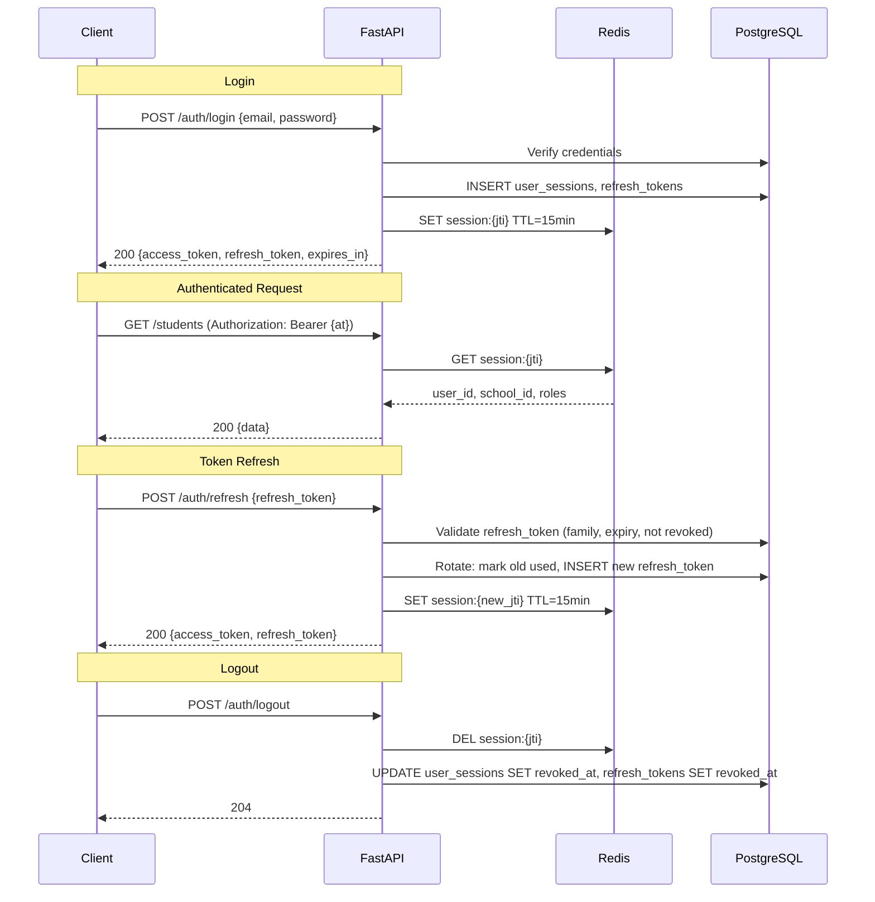

# 03 — API Design

> **Version:** 1.0 | **Phase:** 1 | **Status:** Approved (pending gate)

---

## Table of Contents

1. [API Conventions](#1-api-conventions)
2. [Authentication & Authorization](#2-authentication--authorization)
3. [Endpoint Catalogue](#3-endpoint-catalogue)
4. [Request & Response Contracts](#4-request--response-contracts)
5. [Error Handling](#5-error-handling)
6. [Rate Limiting](#6-rate-limiting)
7. [Idempotency](#7-idempotency)
8. [Pagination & Filtering](#8-pagination--filtering)
9. [Versioning & Deprecation](#9-versioning--deprecation)
10. [Webhook Contracts](#10-webhook-contracts)
11. [Health & Readiness](#11-health--readiness)
12. [Assumptions and Open Questions](#12-assumptions-and-open-questions)

---

## 1. API Conventions

### 1.1 Base URL

```
https://{domain}/api/v1
```

| Environment | Domain |
|---|---|
| Local | `localhost:8000/api/v1` |
| Staging | `staging-api.schoolerp.in/api/v1` |
| Production | `api.schoolerp.in/api/v1` |

### 1.2 Naming Rules

| Rule | Example |
|---|---|
| Plural nouns for resources | `/students`, `/fees/payments` |
| Kebab-case for multi-word paths | `/academic-years`, `/fee-structures` |
| Verb-less CRUD; verbs only for actions | `POST /attendance/sessions/{id}/lock` |
| Nested max 2 levels deep | `/classes/{id}/sections` ✅, `/classes/{id}/sections/{sid}/students/{stid}` ❌ |
| Query parameters: snake_case | `?page_size=20&sort_by=created_at` |
| Request/response body: snake_case | `{ "first_name": "Ravi" }` |

### 1.3 HTTP Methods

| Method | Semantics | Idempotent | Safe |
|---|---|---|---|
| `GET` | Read resource(s) | Yes | Yes |
| `POST` | Create resource or trigger action | No* | No |
| `PUT` | Full resource replacement | Yes | No |
| `PATCH` | Partial update | No | No |
| `DELETE` | Soft-delete (set `deleted_at`) | Yes | No |

\* `POST` is made idempotent via `Idempotency-Key` header for critical operations (fees, attendance).

### 1.4 Standard Headers

| Header | Direction | Required | Description |
|---|---|---|---|
| `Authorization` | Request | Yes* | `Bearer {access_token}` |
| `X-Request-ID` | Request | No (auto-gen) | UUID4; echoed in response for tracing |
| `X-School-ID` | Request | Context | School context; injected from JWT claim for tenant scoping |
| `Idempotency-Key` | Request | Conditional | Required for `POST` on critical endpoints |
| `Content-Type` | Both | Yes | `application/json` (default) |
| `X-Request-ID` | Response | Always | Echoed or generated UUID |
| `X-RateLimit-Limit` | Response | Always | Requests allowed per window |
| `X-RateLimit-Remaining` | Response | Always | Requests remaining |
| `X-RateLimit-Reset` | Response | Always | Unix timestamp when window resets |
| `Retry-After` | Response | On 429 | Seconds until next request is allowed |

\* Exceptions: login, OAuth callback, webhooks, health endpoints.

---

## 2. Authentication & Authorization

### 2.1 Token Lifecycle



### 2.2 JWT Claims

```json
{
  "sub": "user-uuid",
  "jti": "session-jti-uuid",
  "school_id": "school-uuid",
  "roles": ["teacher"],
  "permissions": ["attendance.submit", "attendance.view", "homework.create"],
  "iat": 1698300000,
  "exp": 1698300900
}
```

| Field | Type | Description |
|---|---|---|
| `sub` | UUID | User ID |
| `jti` | UUID | Session identifier; maps to Redis `session:{jti}` |
| `school_id` | UUID | Tenant context; `null` for `super_admin` |
| `roles` | string[] | Active roles for this session |
| `permissions` | string[] | Flattened permission slugs from `role_permissions` |
| `iat` | int | Issued-at (Unix epoch) |
| `exp` | int | Expiry (15 min after `iat`) |

### 2.3 Permission Model

Permissions follow `{module}.{action}` pattern:

| Module | Permissions |
|---|---|
| `students` | `students.create`, `students.view`, `students.update`, `students.delete`, `students.export` |
| `attendance` | `attendance.submit`, `attendance.view`, `attendance.correct`, `attendance.lock`, `attendance.report` |
| `fees` | `fees.view`, `fees.collect`, `fees.create_structure`, `fees.refund`, `fees.report`, `fees.waive` |
| `exams` | `exams.create`, `exams.view`, `exams.enter_marks`, `exams.publish`, `exams.report` |
| `homework` | `homework.create`, `homework.view`, `homework.grade` |
| `timetable` | `timetable.create`, `timetable.view`, `timetable.publish` |
| `library` | `library.manage_books`, `library.issue`, `library.return`, `library.view` |
| `transport` | `transport.manage`, `transport.view`, `transport.assign` |
| `notifications` | `notifications.send`, `notifications.view`, `notifications.manage_templates` |
| `users` | `users.create`, `users.view`, `users.update`, `users.delete`, `users.assign_role` |
| `settings` | `settings.view`, `settings.update` |
| `reports` | `reports.generate`, `reports.view`, `reports.export` |
| `audit` | `audit.view` |

### 2.4 Endpoint Authorization

```python
# Router-level permission check (decorator pattern)
@router.post("/attendance/sessions/{session_id}/records")
@require_permissions("attendance.submit")
async def submit_attendance(
    session_id: UUID,
    payload: AttendanceBulkCreateSchema,
    current_user: AuthenticatedUser = Depends(get_current_user),
):
    ...
```

Row-level scope is applied in the **repository layer**:

```python
# Repository: teacher sees only their assigned sections
class AttendanceRepository:
    async def get_sessions(self, school_id: UUID, user: AuthenticatedUser, filters: dict):
        query = select(AttendanceSession).where(
            AttendanceSession.school_id == school_id
        )
        if "teacher" in user.roles and "school_admin" not in user.roles:
            teacher_section_ids = await self._get_teacher_section_ids(user.id)
            query = query.where(AttendanceSession.section_id.in_(teacher_section_ids))
        ...
```

### 2.5 Google OAuth Flow

```
GET /auth/google/authorize → 302 redirect to Google
GET /auth/google/callback?code=...&state=... → exchange code → upsert user → issue tokens
```

---

## 3. Endpoint Catalogue

### 3.1 Auth

| Method | Path | Permission | Description |
|---|---|---|---|
| `POST` | `/auth/login` | Public | Email/password login |
| `POST` | `/auth/otp-verify` | Public | OTP verification (2FA) |
| `POST` | `/auth/refresh` | Public | Rotate refresh token |
| `POST` | `/auth/logout` | Authenticated | Revoke session |
| `POST` | `/auth/logout-all` | Authenticated | Revoke all sessions for user |
| `POST` | `/auth/forgot-password` | Public | Send password reset email/SMS |
| `POST` | `/auth/reset-password` | Public | Reset password with token |
| `POST` | `/auth/change-password` | Authenticated | Change password (requires old) |
| `GET` | `/auth/google/authorize` | Public | Initiate Google OAuth |
| `GET` | `/auth/google/callback` | Public | Google OAuth callback |
| `GET` | `/auth/me` | Authenticated | Get current user profile |
| `PATCH` | `/auth/me` | Authenticated | Update current user profile |

### 3.2 Schools (Super Admin)

| Method | Path | Permission | Description |
|---|---|---|---|
| `GET` | `/schools` | `super_admin` | List all schools |
| `POST` | `/schools` | `super_admin` | Create a new school |
| `GET` | `/schools/{id}` | `super_admin` | Get school details |
| `PATCH` | `/schools/{id}` | `super_admin` | Update school |
| `DELETE` | `/schools/{id}` | `super_admin` | Soft-delete school |
| `PATCH` | `/schools/{id}/status` | `super_admin` | Change school status (suspend/activate) |
| `GET` | `/schools/{id}/settings` | `settings.view` | Get school settings |
| `PATCH` | `/schools/{id}/settings` | `settings.update` | Update school settings |

### 3.3 Academic Years

| Method | Path | Permission | Description |
|---|---|---|---|
| `GET` | `/academic-years` | Authenticated | List academic years for current school |
| `POST` | `/academic-years` | `settings.update` | Create academic year |
| `PATCH` | `/academic-years/{id}` | `settings.update` | Update academic year |
| `POST` | `/academic-years/{id}/activate` | `settings.update` | Set as current academic year |

### 3.4 Users & Roles

| Method | Path | Permission | Description |
|---|---|---|---|
| `GET` | `/users` | `users.view` | List users (filterable by role, status) |
| `POST` | `/users` | `users.create` | Create user (with role assignment) |
| `GET` | `/users/{id}` | `users.view` | Get user detail |
| `PATCH` | `/users/{id}` | `users.update` | Update user |
| `DELETE` | `/users/{id}` | `users.delete` | Soft-delete user |
| `GET` | `/roles` | `users.view` | List all roles |
| `POST` | `/users/{id}/roles` | `users.assign_role` | Assign role to user |
| `DELETE` | `/users/{id}/roles/{role_id}` | `users.assign_role` | Remove role from user |

### 3.5 Students

| Method | Path | Permission | Description |
|---|---|---|---|
| `GET` | `/students` | `students.view` | List students (paginated, filterable) |
| `POST` | `/students` | `students.create` | Admit new student |
| `GET` | `/students/{id}` | `students.view` | Get student detail |
| `PATCH` | `/students/{id}` | `students.update` | Update student |
| `DELETE` | `/students/{id}` | `students.delete` | Soft-delete student |
| `GET` | `/students/{id}/guardians` | `students.view` | List student's guardians |
| `POST` | `/students/{id}/guardians` | `students.update` | Link guardian to student |
| `GET` | `/students/{id}/enrollments` | `students.view` | List enrollment history |
| `POST` | `/students/{id}/enrollments` | `students.create` | Enroll student in section |
| `GET` | `/students/{id}/attendance` | `students.view` | Student attendance summary |
| `GET` | `/students/{id}/fees` | `fees.view` | Student fee summary |
| `GET` | `/students/{id}/marks` | `exams.view` | Student marks across exams |
| `POST` | `/students/import` | `students.create` | Bulk CSV import (async) |
| `GET` | `/students/export` | `students.export` | Export students to CSV/Excel (async) |

### 3.6 Parents

| Method | Path | Permission | Description |
|---|---|---|---|
| `GET` | `/parents` | `students.view` | List parents |
| `POST` | `/parents` | `students.create` | Create parent record |
| `GET` | `/parents/{id}` | `students.view` | Get parent detail |
| `PATCH` | `/parents/{id}` | `students.update` | Update parent |
| `GET` | `/parents/{id}/children` | `students.view` | List parent's linked students |

### 3.7 Teachers & Staff

| Method | Path | Permission | Description |
|---|---|---|---|
| `GET` | `/teachers` | `users.view` | List teachers |
| `POST` | `/teachers` | `users.create` | Create teacher |
| `GET` | `/teachers/{id}` | `users.view` | Get teacher detail |
| `PATCH` | `/teachers/{id}` | `users.update` | Update teacher |
| `DELETE` | `/teachers/{id}` | `users.delete` | Soft-delete teacher |
| `GET` | `/teachers/{id}/subjects` | `users.view` | List teacher's subject assignments |
| `POST` | `/teachers/{id}/subjects` | `users.update` | Assign subject to teacher |
| `GET` | `/staff` | `users.view` | List non-teaching staff |
| `POST` | `/staff` | `users.create` | Create staff member |
| `GET` | `/staff/{id}` | `users.view` | Get staff detail |
| `PATCH` | `/staff/{id}` | `users.update` | Update staff |

### 3.8 Classes & Sections

| Method | Path | Permission | Description |
|---|---|---|---|
| `GET` | `/classes` | Authenticated | List classes for current school |
| `POST` | `/classes` | `settings.update` | Create class |
| `GET` | `/classes/{id}` | Authenticated | Get class detail |
| `PATCH` | `/classes/{id}` | `settings.update` | Update class |
| `GET` | `/classes/{id}/sections` | Authenticated | List sections for a class |
| `POST` | `/classes/{id}/sections` | `settings.update` | Create section |
| `PATCH` | `/sections/{id}` | `settings.update` | Update section |
| `GET` | `/sections/{id}/students` | `students.view` | List students in a section (current year) |

### 3.9 Subjects

| Method | Path | Permission | Description |
|---|---|---|---|
| `GET` | `/subjects` | Authenticated | List subjects |
| `POST` | `/subjects` | `settings.update` | Create subject |
| `PATCH` | `/subjects/{id}` | `settings.update` | Update subject |
| `GET` | `/classes/{id}/subjects` | Authenticated | List subjects for a class |
| `POST` | `/classes/{id}/subjects` | `settings.update` | Assign subject to class |

### 3.10 Attendance

| Method | Path | Permission | Description |
|---|---|---|---|
| `GET` | `/attendance/sessions` | `attendance.view` | List attendance sessions (filterable) |
| `POST` | `/attendance/sessions` | `attendance.submit` | Create attendance session |
| `GET` | `/attendance/sessions/{id}` | `attendance.view` | Get session with records |
| `POST` | `/attendance/sessions/{id}/records` | `attendance.submit` | Bulk submit attendance records (idempotent) |
| `POST` | `/attendance/sessions/{id}/lock` | `attendance.lock` | Lock session (no further edits) |
| `POST` | `/attendance/corrections` | `attendance.correct` | Submit correction request |
| `PATCH` | `/attendance/corrections/{id}/approve` | `attendance.correct` | Approve/reject correction |
| `GET` | `/attendance/reports/section/{section_id}` | `attendance.report` | Section-wise attendance report |
| `GET` | `/attendance/reports/student/{student_id}` | `attendance.view` | Individual student attendance |
| `GET` | `/attendance/reports/daily` | `attendance.report` | School-wide daily summary |

### 3.11 Timetable

| Method | Path | Permission | Description |
|---|---|---|---|
| `GET` | `/timetables` | `timetable.view` | List timetables |
| `POST` | `/timetables` | `timetable.create` | Create timetable |
| `GET` | `/timetables/{id}` | `timetable.view` | Get timetable with periods and entries |
| `PATCH` | `/timetables/{id}` | `timetable.create` | Update timetable metadata |
| `POST` | `/timetables/{id}/periods` | `timetable.create` | Add/replace periods |
| `POST` | `/timetables/{id}/entries` | `timetable.create` | Bulk add entries |
| `POST` | `/timetables/{id}/publish` | `timetable.publish` | Publish timetable |
| `GET` | `/timetables/teacher/{teacher_id}` | `timetable.view` | Teacher's timetable |
| `GET` | `/timetables/section/{section_id}` | `timetable.view` | Section's timetable |

### 3.12 Homework

| Method | Path | Permission | Description |
|---|---|---|---|
| `GET` | `/homework` | `homework.view` | List homework (filterable by section, subject) |
| `POST` | `/homework` | `homework.create` | Create homework |
| `GET` | `/homework/{id}` | `homework.view` | Get homework detail |
| `PATCH` | `/homework/{id}` | `homework.create` | Update homework |
| `DELETE` | `/homework/{id}` | `homework.create` | Soft-delete homework |
| `GET` | `/homework/{id}/submissions` | `homework.grade` | List submissions |
| `POST` | `/homework/{id}/submissions` | Authenticated (student) | Submit homework |
| `PATCH` | `/homework/submissions/{id}` | `homework.grade` | Grade submission |

### 3.13 Exams & Marks

| Method | Path | Permission | Description |
|---|---|---|---|
| `GET` | `/exams` | `exams.view` | List exams |
| `POST` | `/exams` | `exams.create` | Create exam |
| `GET` | `/exams/{id}` | `exams.view` | Get exam detail |
| `PATCH` | `/exams/{id}` | `exams.create` | Update exam |
| `DELETE` | `/exams/{id}` | `exams.create` | Soft-delete exam |
| `GET` | `/exams/{id}/subjects` | `exams.view` | List exam subjects |
| `POST` | `/exams/{id}/subjects` | `exams.create` | Add subjects to exam |
| `GET` | `/exams/{id}/schedules` | `exams.view` | Get exam schedule |
| `POST` | `/exams/{id}/schedules` | `exams.create` | Set exam schedule |
| `GET` | `/exams/{id}/marks` | `exams.view` | Get marks for exam |
| `POST` | `/exams/{id}/marks` | `exams.enter_marks` | Bulk enter marks (idempotent) |
| `PATCH` | `/exams/{id}/marks` | `exams.enter_marks` | Update individual marks |
| `POST` | `/exams/{id}/publish` | `exams.publish` | Publish exam results |
| `GET` | `/grading-systems` | `exams.view` | List grading systems |
| `POST` | `/grading-systems` | `exams.create` | Create grading system |
| `GET` | `/report-cards/student/{student_id}` | `exams.view` | Get student's report cards |
| `POST` | `/report-cards/generate` | `reports.generate` | Trigger report card generation (async) |

### 3.14 Fees

| Method | Path | Permission | Description |
|---|---|---|---|
| `GET` | `/fee-categories` | `fees.view` | List fee categories |
| `POST` | `/fee-categories` | `fees.create_structure` | Create fee category |
| `GET` | `/fee-structures` | `fees.view` | List fee structures |
| `POST` | `/fee-structures` | `fees.create_structure` | Create fee structure |
| `GET` | `/fee-structures/{id}` | `fees.view` | Get fee structure with installments |
| `PATCH` | `/fee-structures/{id}` | `fees.create_structure` | Update fee structure |
| `POST` | `/fee-structures/{id}/installments` | `fees.create_structure` | Set installments |
| `GET` | `/student-fees` | `fees.view` | List student fee assignments |
| `POST` | `/student-fees/assign` | `fees.create_structure` | Bulk assign fees to students |
| `GET` | `/student-fees/{id}` | `fees.view` | Get student fee detail |
| `POST` | `/fees/orders` | Authenticated (parent) | Create payment order (Razorpay/Stripe) |
| `POST` | `/fees/payments/cash` | `fees.collect` | Record cash/cheque payment |
| `GET` | `/fees/payments` | `fees.view` | List payments (filterable) |
| `GET` | `/fees/payments/{id}` | `fees.view` | Get payment detail |
| `GET` | `/fees/receipts/{id}` | `fees.view` | Get receipt detail + download URL |
| `POST` | `/fees/refunds` | `fees.refund` | Initiate refund |
| `POST` | `/fees/discounts` | `fees.waive` | Apply discount |
| `GET` | `/fees/reports/collection` | `fees.report` | Fee collection summary report |
| `GET` | `/fees/reports/defaulters` | `fees.report` | Defaulter list |

### 3.15 Leave

| Method | Path | Permission | Description |
|---|---|---|---|
| `GET` | `/leave-requests` | Authenticated | List leave requests (scoped by role) |
| `POST` | `/leave-requests` | Authenticated | Submit leave request |
| `GET` | `/leave-requests/{id}` | Authenticated | Get leave request detail |
| `PATCH` | `/leave-requests/{id}` | Authenticated | Cancel own request |
| `POST` | `/leave-requests/{id}/review` | `users.update` | Approve/reject leave |

### 3.16 Library

| Method | Path | Permission | Description |
|---|---|---|---|
| `GET` | `/library/books` | `library.view` | List/search books |
| `POST` | `/library/books` | `library.manage_books` | Add book |
| `GET` | `/library/books/{id}` | `library.view` | Get book detail with copies |
| `PATCH` | `/library/books/{id}` | `library.manage_books` | Update book |
| `DELETE` | `/library/books/{id}` | `library.manage_books` | Soft-delete book |
| `POST` | `/library/books/{id}/copies` | `library.manage_books` | Add copies |
| `POST` | `/library/issues` | `library.issue` | Issue book to user |
| `POST` | `/library/issues/{id}/return` | `library.return` | Return book |
| `GET` | `/library/issues` | `library.view` | List active issues |
| `GET` | `/library/overdue` | `library.view` | List overdue books |
| `GET` | `/library/fines` | `library.view` | List fines |
| `POST` | `/library/fines/{id}/pay` | `library.issue` | Mark fine as paid |
| `GET` | `/library/categories` | `library.view` | List categories |
| `POST` | `/library/categories` | `library.manage_books` | Create category |

### 3.17 Transport

| Method | Path | Permission | Description |
|---|---|---|---|
| `GET` | `/transport/routes` | `transport.view` | List routes |
| `POST` | `/transport/routes` | `transport.manage` | Create route |
| `GET` | `/transport/routes/{id}` | `transport.view` | Get route with stops |
| `PATCH` | `/transport/routes/{id}` | `transport.manage` | Update route |
| `POST` | `/transport/routes/{id}/stops` | `transport.manage` | Add/replace stops |
| `GET` | `/transport/buses` | `transport.view` | List buses |
| `POST` | `/transport/buses` | `transport.manage` | Add bus |
| `PATCH` | `/transport/buses/{id}` | `transport.manage` | Update bus |
| `GET` | `/transport/drivers` | `transport.view` | List drivers |
| `POST` | `/transport/drivers` | `transport.manage` | Add driver |
| `POST` | `/transport/assign` | `transport.assign` | Assign student to route/stop |
| `GET` | `/transport/students` | `transport.view` | List student transport assignments |

### 3.18 Notifications & Messaging

| Method | Path | Permission | Description |
|---|---|---|---|
| `GET` | `/notifications` | Authenticated | List user's notifications (paginated) |
| `GET` | `/notifications/unread-count` | Authenticated | Get unread notification count |
| `PATCH` | `/notifications/{id}/read` | Authenticated | Mark notification as read |
| `POST` | `/notifications/mark-all-read` | Authenticated | Mark all as read |
| `POST` | `/notifications/send` | `notifications.send` | Send notification (admin) |
| `GET` | `/notification-templates` | `notifications.manage_templates` | List templates |
| `POST` | `/notification-templates` | `notifications.manage_templates` | Create template |
| `PATCH` | `/notification-templates/{id}` | `notifications.manage_templates` | Update template |
| `GET` | `/conversations` | Authenticated | List conversations |
| `POST` | `/conversations` | Authenticated | Start conversation |
| `GET` | `/conversations/{id}/messages` | Authenticated | Get messages (cursor paginated) |
| `POST` | `/conversations/{id}/messages` | Authenticated | Send message |

### 3.19 Reports

| Method | Path | Permission | Description |
|---|---|---|---|
| `POST` | `/reports/request` | `reports.generate` | Request report generation (async) |
| `GET` | `/reports/{request_id}` | `reports.view` | Check report status / download |
| `GET` | `/reports` | `reports.view` | List generated reports |

### 3.20 Files & Documents

| Method | Path | Permission | Description |
|---|---|---|---|
| `POST` | `/files/upload-url` | Authenticated | Get pre-signed upload URL |
| `POST` | `/files/confirm` | Authenticated | Confirm upload complete; register metadata |
| `GET` | `/files/{id}` | Authenticated | Get file metadata + signed download URL |
| `GET` | `/students/{id}/documents` | `students.view` | List student documents |
| `POST` | `/students/{id}/documents` | `students.update` | Upload student document |

### 3.21 Audit Logs

| Method | Path | Permission | Description |
|---|---|---|---|
| `GET` | `/audit-logs` | `audit.view` | List audit logs (filterable) |
| `GET` | `/audit-logs/{id}` | `audit.view` | Get audit log detail |

### 3.22 Dashboard

| Method | Path | Permission | Description |
|---|---|---|---|
| `GET` | `/dashboard/admin` | `students.view` | Admin dashboard data |
| `GET` | `/dashboard/teacher` | `attendance.view` | Teacher dashboard data |
| `GET` | `/dashboard/parent` | Authenticated (parent) | Parent dashboard (ward summary) |

---

## 4. Request & Response Contracts

### 4.1 Success Envelope

All successful responses use a standard envelope:

```json
{
  "data": { ... },
  "meta": {
    "request_id": "a1b2c3d4-e5f6-7890-abcd-ef1234567890",
    "timestamp": "2025-10-04T15:30:00Z",
    "pagination": {
      "page": 1,
      "page_size": 20,
      "total_items": 142,
      "total_pages": 8,
      "has_next": true,
      "has_previous": false
    }
  }
}
```

- `data` — single object for detail, array for lists
- `meta.pagination` — present only for paginated list responses

### 4.2 Example: Create Student

**Request:**

```http
POST /api/v1/students
Authorization: Bearer eyJhbG...
Content-Type: application/json
X-Request-ID: 550e8400-e29b-41d4-a716-446655440000

{
  "first_name": "Ravi",
  "last_name": "Kumar",
  "email": "ravi.kumar@example.com",
  "phone": "+919876543210",
  "admission_number": "ADM-2025-0042",
  "admission_date": "2025-06-15",
  "date_of_birth": "2012-03-20",
  "gender": "male",
  "blood_group": "B+",
  "nationality": "IN",
  "section_id": "sec-uuid-here",
  "guardian": {
    "parent_id": "parent-uuid-here",
    "relationship": "father",
    "is_primary": true
  }
}
```

**Response: `201 Created`**

```json
{
  "data": {
    "id": "stu-uuid-here",
    "school_id": "school-uuid-here",
    "user_id": "user-uuid-here",
    "admission_number": "ADM-2025-0042",
    "admission_date": "2025-06-15",
    "first_name": "Ravi",
    "last_name": "Kumar",
    "display_name": "Ravi Kumar",
    "date_of_birth": "2012-03-20",
    "gender": "male",
    "blood_group": "B+",
    "nationality": "IN",
    "status": "active",
    "enrollment": {
      "section_id": "sec-uuid-here",
      "section_name": "A",
      "class_name": "Grade 6",
      "academic_year": "2025-26",
      "roll_number": null
    },
    "created_at": "2025-10-04T15:30:00Z",
    "updated_at": "2025-10-04T15:30:00Z"
  },
  "meta": {
    "request_id": "550e8400-e29b-41d4-a716-446655440000",
    "timestamp": "2025-10-04T15:30:00Z"
  }
}
```

### 4.3 Example: Bulk Attendance Submit

**Request:**

```http
POST /api/v1/attendance/sessions/sess-uuid/records
Authorization: Bearer eyJhbG...
Idempotency-Key: att-2025-10-04-sec-a-full-day
Content-Type: application/json

{
  "records": [
    { "student_id": "stu-1", "status": "present" },
    { "student_id": "stu-2", "status": "absent", "remarks": "Informed leave" },
    { "student_id": "stu-3", "status": "late" }
  ]
}
```

**Response: `201 Created`**

```json
{
  "data": {
    "session_id": "sess-uuid",
    "total_present": 38,
    "total_absent": 1,
    "total_late": 1,
    "records_saved": 40
  },
  "meta": {
    "request_id": "req-uuid",
    "timestamp": "2025-10-04T09:30:00Z",
    "idempotency_key": "att-2025-10-04-sec-a-full-day",
    "idempotency_status": "created"
  }
}
```

### 4.4 Example: Create Fee Payment Order

**Request:**

```http
POST /api/v1/fees/orders
Authorization: Bearer eyJhbG...
Idempotency-Key: fee-order-stu1-2025-term1
Content-Type: application/json

{
  "student_fee_id": "sf-uuid",
  "installment_ids": ["inst-1-uuid", "inst-2-uuid"],
  "amount": 5000000
}
```

**Response: `200 OK`**

```json
{
  "data": {
    "payment_id": "pay-uuid",
    "gateway_order_id": "order_LkjH123456",
    "gateway_provider": "razorpay",
    "razorpay_key_id": "rzp_live_xxxx",
    "amount": 5000000,
    "currency": "INR",
    "description": "Tuition Fee - Term 1 & Term 2 - Ravi Kumar",
    "prefill": {
      "name": "Arun Kumar",
      "email": "arun.kumar@example.com",
      "contact": "+919876543210"
    }
  },
  "meta": {
    "request_id": "req-uuid",
    "timestamp": "2025-10-04T10:00:00Z"
  }
}
```

---

## 5. Error Handling

### 5.1 Error Envelope

```json
{
  "error": {
    "code": "VALIDATION_ERROR",
    "message": "Request validation failed",
    "details": [
      {
        "field": "date_of_birth",
        "message": "Date must be in the past",
        "code": "date_past"
      },
      {
        "field": "admission_number",
        "message": "Admission number already exists",
        "code": "unique_violation"
      }
    ]
  },
  "meta": {
    "request_id": "550e8400-e29b-41d4-a716-446655440000",
    "timestamp": "2025-10-04T15:30:00Z"
  }
}
```

### 5.2 Error Codes

| HTTP Status | Error Code | Description |
|---|---|---|
| `400` | `VALIDATION_ERROR` | Request body/query parameter validation failed |
| `400` | `BAD_REQUEST` | Malformed request or missing required header |
| `401` | `UNAUTHORIZED` | Missing, expired, or invalid access token |
| `401` | `TOKEN_EXPIRED` | Access token expired; client should refresh |
| `401` | `INVALID_CREDENTIALS` | Wrong email/password |
| `403` | `FORBIDDEN` | Authenticated but insufficient permissions |
| `403` | `TENANT_MISMATCH` | Attempting to access resource from another school |
| `404` | `NOT_FOUND` | Resource does not exist or soft-deleted |
| `409` | `CONFLICT` | Duplicate resource (unique constraint violation) |
| `409` | `STATE_CONFLICT` | Invalid state transition (e.g., publishing already-published exam) |
| `422` | `UNPROCESSABLE_ENTITY` | Semantically invalid (e.g., end_date before start_date) |
| `429` | `RATE_LIMITED` | Too many requests; `Retry-After` header included |
| `500` | `INTERNAL_ERROR` | Unhandled server error; request_id for support |
| `502` | `GATEWAY_ERROR` | Upstream service failure (payment gateway, SMS, etc.) |
| `503` | `SERVICE_UNAVAILABLE` | System overloaded or in maintenance |

### 5.3 Error Hierarchy (Backend)

```python
class AppError(Exception):
    """Base error: all application errors extend this."""
    status_code: int = 500
    error_code: str = "INTERNAL_ERROR"
    message: str = "An unexpected error occurred"

class ValidationError(AppError):
    status_code = 400
    error_code = "VALIDATION_ERROR"

class AuthenticationError(AppError):
    status_code = 401
    error_code = "UNAUTHORIZED"

class AuthorizationError(AppError):
    status_code = 403
    error_code = "FORBIDDEN"

class NotFoundError(AppError):
    status_code = 404
    error_code = "NOT_FOUND"

class ConflictError(AppError):
    status_code = 409
    error_code = "CONFLICT"

class RateLimitError(AppError):
    status_code = 429
    error_code = "RATE_LIMITED"

class GatewayError(AppError):
    status_code = 502
    error_code = "GATEWAY_ERROR"
```

### 5.4 Error Mapping (Flutter)

```dart
sealed class Failure {
  final String message;
  final String? requestId;
  const Failure(this.message, {this.requestId});
}

class NetworkFailure extends Failure { ... }
class ServerFailure extends Failure {
  final String errorCode;
  final int statusCode;
  ...
}
class AuthFailure extends Failure { ... }
class ValidationFailure extends Failure {
  final List<FieldError> fieldErrors;
  ...
}
class CacheFailure extends Failure { ... }
```

---

## 6. Rate Limiting

### 6.1 Rate Limit Tiers

| Tier | Scope | Limit | Window | Applies To |
|---|---|---|---|---|
| Auth | IP | 10 requests | 1 min | `/auth/login`, `/auth/forgot-password` |
| OTP | User | 5 requests | 5 min | `/auth/otp-verify` |
| Write | School + User | 60 requests | 1 min | All `POST`, `PUT`, `PATCH`, `DELETE` |
| Read | School + User | 300 requests | 1 min | All `GET` |
| Upload | School + User | 10 requests | 1 min | `/files/upload-url` |
| Webhook | IP | 100 requests | 1 min | `/webhooks/*` |

### 6.2 Implementation

```python
# Redis-based sliding window
# Key: rl:{tier}:{scope_key}
# Algorithm: sorted set with timestamp scores (sliding window log)

async def check_rate_limit(tier: str, scope_key: str) -> RateLimitResult:
    key = f"rl:{tier}:{scope_key}"
    now = time.time()
    window_start = now - tier.window_seconds

    pipe = redis.pipeline()
    pipe.zremrangebyscore(key, 0, window_start)  # remove expired
    pipe.zadd(key, {str(now): now})               # add current
    pipe.zcard(key)                                # count in window
    pipe.expire(key, tier.window_seconds)          # auto-cleanup
    _, _, count, _ = await pipe.execute()

    return RateLimitResult(
        allowed=count <= tier.limit,
        limit=tier.limit,
        remaining=max(0, tier.limit - count),
        reset=int(now + tier.window_seconds),
        retry_after=tier.window_seconds if count > tier.limit else None,
    )
```

### 6.3 Response Headers

```http
HTTP/1.1 429 Too Many Requests
X-RateLimit-Limit: 10
X-RateLimit-Remaining: 0
X-RateLimit-Reset: 1698300120
Retry-After: 45
Content-Type: application/json

{
  "error": {
    "code": "RATE_LIMITED",
    "message": "Too many login attempts. Please try again in 45 seconds."
  },
  "meta": { "request_id": "..." }
}
```

---

## 7. Idempotency

### 7.1 Idempotent Endpoints

| Endpoint | Why |
|---|---|
| `POST /attendance/sessions/{id}/records` | Teacher may retry on flaky network; prevents duplicate attendance |
| `POST /fees/orders` | Prevents duplicate payment order creation |
| `POST /fees/payments/cash` | Prevents double-entry of cash payments |
| `POST /exams/{id}/marks` | Bulk marks entry retry safety |
| `POST /students/import` | Large CSV import retry |
| `POST /notifications/send` | Prevents duplicate notification dispatch |

### 7.2 Protocol

1. Client sends `Idempotency-Key: {unique-key}` header.
2. Server checks Redis `idem:{school_id}:{key}`:
   - **Hit:** Return cached response (replay). `meta.idempotency_status = "replayed"`.
   - **Miss:** Process request, cache response in Redis (TTL: 24h) and DB (`idempotency_keys` table). `meta.idempotency_status = "created"`.
3. If a request is in-flight for the same key, return `409 CONFLICT` with `error.code = "IDEMPOTENCY_IN_FLIGHT"`.

### 7.3 Key Generation Guidelines (Client)

| Endpoint | Recommended Key Format |
|---|---|
| Attendance | `att-{date}-{section_id}-{session_type}` |
| Fee order | `fee-order-{student_fee_id}-{installment_ids_hash}` |
| Cash payment | `cash-{student_fee_id}-{amount}-{date}` |
| Marks | `marks-{exam_id}-{subject_id}-{class_id}` |
| Import | `import-{file_hash}-{timestamp}` |

---

## 8. Pagination & Filtering

### 8.1 Offset Pagination (Default)

```http
GET /api/v1/students?page=2&page_size=20&sort_by=admission_number&sort_order=asc
```

**Response `meta.pagination`:**

```json
{
  "page": 2,
  "page_size": 20,
  "total_items": 142,
  "total_pages": 8,
  "has_next": true,
  "has_previous": true
}
```

- Maximum `page_size`: 100
- Default `page_size`: 20
- Default `sort_order`: `desc` (by `created_at`)

### 8.2 Cursor Pagination (High-Volume)

Used for: messages, notifications, audit logs.

```http
GET /api/v1/conversations/conv-uuid/messages?cursor=eyJjcmVhdGVkX2F0IjoiMjAyNS0xMC0wNCJ9&limit=50
```

**Response `meta.pagination`:**

```json
{
  "cursor": "eyJjcmVhdGVkX2F0IjoiMjAyNS0xMC0wMyJ9",
  "next_cursor": "eyJjcmVhdGVkX2F0IjoiMjAyNS0wOS0yNSJ9",
  "has_next": true,
  "limit": 50
}
```

- Cursor = base64-encoded `{created_at, id}` (opaque to client)
- Maximum `limit`: 100
- Default `limit`: 50

### 8.3 Filtering

Filters are passed as query parameters:

```http
GET /api/v1/students?class_id=cls-uuid&section_id=sec-uuid&status=active&search=ravi&gender=male
```

| Filter Type | Query Param Pattern | Example |
|---|---|---|
| Exact match | `field=value` | `status=active` |
| Multi-value (OR) | `field=val1,val2` | `status=active,suspended` |
| Search (fuzzy) | `search=term` | `search=ravi` (trigram on `display_name`) |
| Date range | `field_from=`, `field_to=` | `created_at_from=2025-01-01&created_at_to=2025-12-31` |
| Boolean | `field=true|false` | `is_optional=true` |

### 8.4 Sorting

```http
GET /api/v1/students?sort_by=admission_number&sort_order=asc
```

- Only pre-defined sortable fields are allowed per endpoint (prevent injection)
- Default: `sort_by=created_at&sort_order=desc`
- Multi-sort (Phase 3+): `sort_by=class_level,admission_number&sort_order=asc,asc`

---

## 9. Versioning & Deprecation

### 9.1 Versioning Strategy

- **URL-based:** `/api/v1/`, `/api/v2/`
- Only major breaking changes warrant a new version
- Within a version, additive changes (new fields, new endpoints) are non-breaking
- Removing/renaming fields is a breaking change → new version

### 9.2 Deprecation Policy

1. **Announce:** Add `Sunset: <date>` and `Deprecation: true` response headers.
2. **Grace period:** Minimum 6 months after announcement.
3. **Documentation:** Mark as deprecated in API docs with migration guide.
4. **Monitoring:** Log usage of deprecated endpoints; alert if usage is above threshold.
5. **Removal:** After grace period, return `410 Gone` with migration instructions.

### 9.3 Deprecation Headers

```http
HTTP/1.1 200 OK
Deprecation: true
Sunset: Sat, 01 Apr 2026 00:00:00 GMT
Link: </api/v2/students>; rel="successor-version"
```

---

## 10. Webhook Contracts

### 10.1 Inbound Webhooks

#### Razorpay Payment Webhook

```http
POST /api/v1/webhooks/razorpay
Content-Type: application/json
X-Razorpay-Signature: {hmac_sha256_signature}

{
  "entity": "event",
  "event": "payment.captured",
  "payload": {
    "payment": {
      "entity": {
        "id": "pay_LkjH123456",
        "order_id": "order_LkjH123456",
        "amount": 5000000,
        "currency": "INR",
        "status": "captured",
        "method": "upi"
      }
    }
  }
}
```

**Processing:**

1. Verify HMAC-SHA256 signature.
2. Return `200 OK` immediately.
3. Dispatch to Celery `critical` queue for processing.
4. Idempotent: if payment already processed, skip.

#### Stripe Payment Webhook

```http
POST /api/v1/webhooks/stripe
Content-Type: application/json
Stripe-Signature: t=...,v1=...

{
  "type": "checkout.session.completed",
  "data": {
    "object": {
      "id": "cs_live_xxx",
      "payment_intent": "pi_xxx",
      "amount_total": 5000000,
      "currency": "inr",
      "status": "complete"
    }
  }
}
```

### 10.2 Webhook Security

| Gateway | Verification Method |
|---|---|
| Razorpay | `HMAC-SHA256(webhook_secret, request_body)` vs `X-Razorpay-Signature` |
| Stripe | `stripe.webhooks.constructEvent(body, sig, endpoint_secret)` |

### 10.3 Webhook Retry Handling

- Webhook endpoints must respond within **5 seconds**.
- Heavy processing is deferred to Celery.
- Gateways retry on non-2xx: Razorpay retries up to 24h; Stripe retries up to 3 days.
- Our endpoint is idempotent: processing same event twice has no side effects.

---

## 11. Health & Readiness

### 11.1 Endpoints

| Endpoint | Auth | Purpose |
|---|---|---|
| `GET /health` | None | Basic liveness check (responds `200` if process is alive) |
| `GET /ready` | None | Readiness check (DB + Redis connectivity) |
| `GET /api/v1/system/info` | `super_admin` | Detailed system info (version, uptime, feature flags) |

### 11.2 Health Response

```json
{
  "status": "healthy",
  "version": "1.0.0",
  "uptime_seconds": 86400
}
```

### 11.3 Readiness Response

```json
{
  "status": "ready",
  "checks": {
    "database": { "status": "up", "latency_ms": 2 },
    "redis": { "status": "up", "latency_ms": 1 },
    "object_storage": { "status": "up", "latency_ms": 15 }
  }
}
```

If any check fails:

```json
{
  "status": "not_ready",
  "checks": {
    "database": { "status": "up", "latency_ms": 2 },
    "redis": { "status": "down", "error": "Connection refused" },
    "object_storage": { "status": "up", "latency_ms": 15 }
  }
}
```

Returns `503 Service Unavailable` if `status` is `not_ready`.

---

## 12. Assumptions and Open Questions

### Assumptions

1. All endpoints return JSON; no XML/HTML responses from the API.
2. File uploads use pre-signed URLs (client → S3 direct), not multipart to API server.
3. Maximum request body size: 1 MB (JSON). File uploads bypass this via pre-signed URLs.
4. All timestamps in responses are UTC ISO 8601 (`2025-10-04T15:30:00Z`).
5. All UUIDs are v4 (random); no sequential or time-based UUIDs.
6. Bulk operations (attendance, marks, fee assignment) are limited to 500 items per request.
7. Search endpoints use trigram matching for Phase 1; full-text search (tsvector) deferred to Phase 3.
8. API docs auto-generated from Pydantic schemas via FastAPI's OpenAPI integration.
9. CORS configured for admin domain and `localhost:3000` (dev); Flutter apps don't require CORS.
10. `super_admin` endpoints are not exposed on the mobile API; admin panel only.

### Open Questions

1. **GraphQL gateway:** Should we add a GraphQL layer for the Flutter app to reduce round-trips (especially dashboard aggregates), or optimize REST endpoints with embedded relations?
2. **Real-time updates:** SSE (`/api/v1/events/stream`) or WebSocket (`wss://`) for in-app notification delivery and live attendance status?
3. **API key authentication:** Should we support API keys (in addition to JWT) for school-level integrations (e.g., external accounting software)?
4. **Batch API:** Should we implement a batch endpoint (`POST /api/v1/batch`) that accepts multiple operations in one request for offline sync?
5. **Field-level permissions:** Should certain fields (e.g., `medical_notes`, `aadhaar_hash`, `annual_income_range`) be excluded from API responses based on the caller's role, or handled entirely via separate restricted endpoints?
