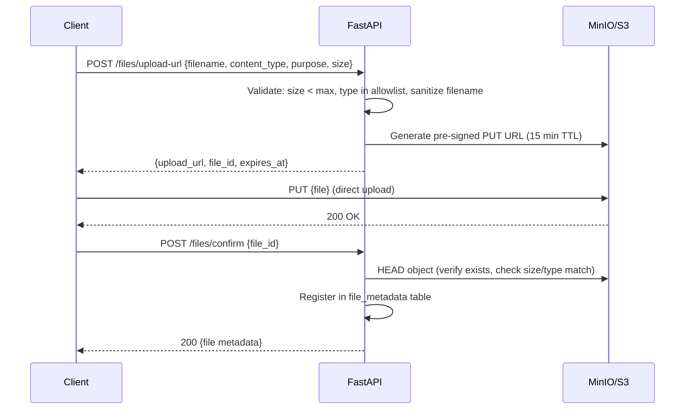

# 04 — Security & Infrastructure

> **Version:** 1.0 | **Phase:** 1 | **Status:** Approved (pending gate)

---

## Table of Contents

1. [Authentication Security](#1-authentication-security)
2. [Authorization Enforcement](#2-authorization-enforcement)
3. [Tenant Isolation](#3-tenant-isolation)
4. [OWASP Protections](#4-owasp-protections)
5. [Encryption](#5-encryption)
6. [File Upload Security](#6-file-upload-security)
7. [Security Headers & CORS](#7-security-headers--cors)
8. [Audit Logging](#8-audit-logging)
9. [Privacy & Data Protection](#9-privacy--data-protection)
10. [Infrastructure — Docker Compose](#10-infrastructure--docker-compose)
11. [CI/CD Pipeline](#11-cicd-pipeline)
12. [Observability](#12-observability)
13. [Backup & Disaster Recovery](#13-backup--disaster-recovery)
14. [Deployment Architecture](#14-deployment-architecture)
15. [Environment Configuration](#15-environment-configuration)

---

## 1. Authentication Security

### 1.1 Password Hashing

```python
# Argon2id — OWASP-recommended configuration
ARGON2_TIME_COST = 3        # iterations
ARGON2_MEMORY_COST = 65536  # 64 MB
ARGON2_PARALLELISM = 4      # threads
ARGON2_HASH_LENGTH = 32     # bytes
ARGON2_SALT_LENGTH = 16     # bytes (auto-generated)
```

- **Algorithm:** Argon2id (memory-hard, resistant to GPU/ASIC attacks)
- **Migration:** If any legacy bcrypt hashes exist, rehash on next successful login
- **Never:** store plaintext, MD5, SHA-1, or unsalted SHA-256

### 1.2 JWT Security

| Parameter | Value | Rationale |
|---|---|---|
| Algorithm | RS256 (RSA 2048-bit) | Asymmetric; API servers verify without signing key |
| Access token TTL | 15 minutes | Limits exposure window |
| Refresh token TTL | 30 days | Mobile UX; revocable |
| Issuer (`iss`) | `schoolerp.in` | Validated on every request |
| Audience (`aud`) | `api` | Validated; prevents token reuse across services |
| Key rotation | Every 90 days | Old public key kept for verification during overlap |

**Key storage:**
- Private key: environment variable `JWT_PRIVATE_KEY` (PEM, never committed)
- Public key: environment variable `JWT_PUBLIC_KEY` (PEM)
- JWKS endpoint: `GET /.well-known/jwks.json` (for admin Next.js verification)

### 1.3 Refresh Token Security

```
┌─────────────────────────────────────────────────────────┐
│                    Refresh Token Flow                    │
├─────────────────────────────────────────────────────────┤
│  1. Login → generate refresh_token (random 256-bit)     │
│  2. Store SHA-256(token) in DB with family_id            │
│  3. Client stores raw token in secure storage            │
│  4. On refresh → verify hash, check family, check expiry │
│  5. Issue new token, mark old as used                    │
│  6. REUSE DETECTED → revoke entire family                │
│     (attacker replayed a used token)                     │
│  7. On logout → revoke all tokens in session             │
│  8. On password change → revoke ALL user sessions        │
└─────────────────────────────────────────────────────────┘
```

**Reuse detection:** If a refresh token that was already `used_at` is presented again, the entire `family_id` chain is revoked and the user is forced to re-authenticate. This catches token theft.

### 1.4 Session Management

| Rule | Implementation |
|---|---|
| Concurrent sessions | Max 5 per user (configurable per school) |
| Session visibility | User can view/revoke active sessions from profile |
| Forced logout | Password change → revoke all sessions |
| Device tracking | Store `device_name`, `device_type`, `ip_address`, `user_agent` |
| Admin session | 2FA required; session TTL 8 hours (shorter than mobile) |

### 1.5 OTP Security

| Parameter | Value |
|---|---|
| Length | 6 digits |
| TTL | 5 minutes |
| Max attempts | 5 per OTP |
| Rate limit | 3 OTP requests per phone/email per 10 minutes |
| Delivery | SMS (MSG91) or email (Resend/SES) |
| Storage | `code_hash` (SHA-256) in `otp_codes` table |
| Lockout | After 5 failed attempts, block OTP verification for 30 minutes |

### 1.6 Google OAuth Security

- Validate `id_token` using Google's public keys (JWKS)
- Verify `iss`, `aud` (our client ID), `exp`
- Store `google_sub` (not email) as the link — emails can change
- `state` parameter: random 32-byte hex, stored in Redis (TTL: 10 min)
- PKCE (S256) for mobile OAuth flow
- No implicit grant; authorization code flow only

### 1.7 2FA (TOTP) for Admin

| Parameter | Value |
|---|---|
| Algorithm | TOTP (RFC 6238) |
| Secret | 160-bit, encrypted at rest (AES-256-GCM) |
| Time step | 30 seconds |
| Window | ±1 step (allows clock drift) |
| Backup codes | 10 one-time codes, SHA-256 hashed |
| Enforcement | Mandatory for `super_admin`, optional for `school_admin` |

---

## 2. Authorization Enforcement

### 2.1 Three-Layer Model

```
┌──────────────────────────────────────────────────────┐
│  Layer 1: API Gateway (middleware)                     │
│  → Is the user authenticated? Valid JWT?               │
│  → Rate limit check                                   │
├──────────────────────────────────────────────────────┤
│  Layer 2: Permission Check (dependency/decorator)      │
│  → Does the user's role have the required permission?  │
│  → e.g., require_permissions("attendance.create")      │
├──────────────────────────────────────────────────────┤
│  Layer 3: Row-Level Scope (service + repository)       │
│  → Teacher: only their assigned sections               │
│  → Parent: only their linked children                  │
│  → Student: only their own records                     │
│  → Accountant: only financial data for their school    │
└──────────────────────────────────────────────────────┘
```

### 2.2 Permission Check Implementation

```python
# Dependency-based permission enforcement
class PermissionChecker:
    def __init__(self, *required: str):
        self.required = required

    async def __call__(self, current_user: AuthenticatedUser = Depends(get_current_user)):
        if current_user.is_super_admin:
            return current_user
        missing = set(self.required) - set(current_user.permissions)
        if missing:
            raise AuthorizationError(
                message=f"Missing permissions: {', '.join(missing)}",
                code="FORBIDDEN"
            )
        return current_user

# Usage in router
require_permissions = PermissionChecker

@router.post("/attendance/sessions")
async def create_session(
    payload: AttendanceSessionCreate,
    user: AuthenticatedUser = Depends(require_permissions("attendance.create")),
):
    ...
```

### 2.3 Row-Level Scope Rules

| Role | Scope Rule |
|---|---|
| `super_admin` | All schools, all records (audited separately) |
| `school_admin` | Own school only (enforced by `school_id` from JWT) |
| `teacher` | Own school; students/attendance/marks only for assigned sections |
| `parent` | Own school; only linked children's records (via `student_guardians`) |
| `student` | Own school; only own records |
| `accountant` | Own school; fee/payment/receipt data |
| `librarian` | Own school; library data |
| `transport_admin` | Own school; transport data |

---

## 3. Tenant Isolation

### 3.1 Enforcement Layers

```
┌────────────────────────────────────────────┐
│  1. JWT Claim: school_id                    │  ← Set at login, immutable
│     Never accept school_id from request     │
├────────────────────────────────────────────┤
│  2. Middleware: tenant context              │
│     SET LOCAL app.current_school_id = '{}'  │  ← Per-transaction
├────────────────────────────────────────────┤
│  3. Repository: explicit WHERE             │
│     WHERE school_id = :school_id            │  ← Every query
├────────────────────────────────────────────┤
│  4. PostgreSQL RLS: safety net             │
│     USING (school_id = setting)             │  ← DB-level enforcement
└────────────────────────────────────────────┘
```

### 3.2 Tenant Middleware

```python
class TenantMiddleware:
    async def __call__(self, request: Request, call_next):
        user = request.state.user  # set by auth middleware
        if user and user.school_id:
            # Set PostgreSQL session variable for RLS
            async with get_db_session() as session:
                await session.execute(
                    text("SET LOCAL app.current_school_id = :sid"),
                    {"sid": str(user.school_id)}
                )
                if user.is_super_admin:
                    await session.execute(
                        text("SET LOCAL app.is_super_admin = 'true'")
                    )
        response = await call_next(request)
        return response
```

### 3.3 Tenant Leak Testing

Every Phase 2+ PR must include a tenant isolation test:

```python
async def test_tenant_isolation_students(
    school_a_teacher_client,  # JWT for school A
    school_b_student,         # Student in school B
):
    """Teacher in school A must NOT see school B students."""
    resp = await school_a_teacher_client.get(f"/api/v1/students/{school_b_student.id}")
    assert resp.status_code == 404  # Not 403 (don't reveal existence)
```

---

## 4. OWASP Protections

### 4.1 Injection (A03:2021)

| Vector | Protection |
|---|---|
| SQL injection | Parameterized queries via SQLAlchemy; no raw SQL with string formatting |
| NoSQL injection | N/A (no NoSQL) |
| LDAP injection | N/A |
| OS command injection | No `os.system()`, `subprocess` with user input |
| Template injection | Jinja2 sandboxed; notification templates validated at creation |

### 4.2 Broken Authentication (A07:2021)

| Attack | Mitigation |
|---|---|
| Credential stuffing | Rate limit: 10 login attempts/min per IP; progressive delays |
| Brute force | Account lockout after 10 failures (30-min cooldown); CAPTCHA after 5 |
| Session fixation | New session ID on every login; never reuse `jti` |
| JWT theft | Short TTL (15 min); refresh rotation with reuse detection |
| Password spray | Rate limit per IP across all accounts; monitor anomalous login patterns |

### 4.3 Broken Access Control (A01:2021)

| Attack | Mitigation |
|---|---|
| IDOR | UUID primary keys (not sequential); ownership validated in service layer |
| Privilege escalation | Permissions checked per-endpoint; role changes require `users.assign_role` |
| Path traversal | File storage uses random keys; no user input in file paths |
| Force browsing | All admin routes require auth + permission; no security through obscurity |
| Tenant hopping | `school_id` from JWT only; RLS as safety net; 404 (not 403) for wrong-tenant |

### 4.4 XSS (A03:2021)

| Vector | Protection |
|---|---|
| Stored XSS | All output encoded; React/Flutter auto-escape by default |
| Reflected XSS | CSP headers; no inline scripts; input sanitization |
| DOM XSS | Next.js strict mode; no `dangerouslySetInnerHTML` without sanitization |
| API responses | JSON only; `Content-Type: application/json`; no HTML rendering from API |

### 4.5 CSRF

| Context | Protection |
|---|---|
| API (JWT in header) | Not vulnerable (no cookies for auth on API) |
| Admin web (if cookie auth) | `SameSite=Strict`; CSRF token via `next-csrf` |
| Webhook endpoints | Signature verification (no cookie/session) |

### 4.6 Additional OWASP Controls

| Category | Implementation |
|---|---|
| Security misconfiguration | Hardened Docker images; no default credentials; disable debug in production |
| Vulnerable dependencies | `uv audit` in CI; Dependabot/Renovate for automated updates |
| Insufficient logging | Every auth event, permission denial, data mutation logged with request ID |
| SSRF | No user-supplied URLs fetched server-side; webhook URLs validated |
| Mass assignment | Pydantic schemas define exact allowed fields; no `**kwargs` from request |

---

## 5. Encryption

### 5.1 In Transit

| Path | Protocol | Min Version |
|---|---|---|
| Client → Load Balancer | TLS 1.3 (min 1.2) | Required |
| Load Balancer → API | HTTP/1.1 (internal) | TLS if separate hosts |
| API → PostgreSQL | TLS | `sslmode=verify-full` in production |
| API → Redis | TLS | In production; unencrypted in Docker dev |
| API → S3/MinIO | HTTPS | Required |
| API → External APIs | HTTPS | Required |

### 5.2 At Rest

| Data | Method |
|---|---|
| Database disk | OS/cloud-level disk encryption (LUKS / EBS encryption) |
| Database backups | AES-256 encrypted before upload to backup storage |
| Sensitive columns | Application-level AES-256-GCM (Fernet or `cryptography` lib) |
| File storage (S3/MinIO) | Server-side encryption (SSE-S3 or SSE-KMS) |
| Redis | Not encrypted at rest (volatile data only; no PII in cache) |

### 5.3 Sensitive Column Encryption

Columns encrypted at the application level before DB storage:

| Table | Column | Reason |
|---|---|---|
| `school_settings` | `razorpay_key_secret` | Payment credentials |
| `school_settings` | `stripe_secret_key` | Payment credentials |
| `school_settings` | `sms_api_key` | SMS provider key |
| `school_settings` | `smtp_password` | Email credentials |
| `school_settings` | `fcm_server_key` | Push notification key |
| `two_factor_secrets` | `secret` | TOTP secret |

```python
# Encryption service using Fernet (AES-128-CBC with HMAC)
from cryptography.fernet import Fernet

class EncryptionService:
    def __init__(self, key: str):
        self.fernet = Fernet(key.encode())

    def encrypt(self, plaintext: str) -> str:
        return self.fernet.encrypt(plaintext.encode()).decode()

    def decrypt(self, ciphertext: str) -> str:
        return self.fernet.decrypt(ciphertext.encode()).decode()
```

Encryption key: `ENCRYPTION_KEY` environment variable. Rotation supported via key versioning prefix.

---

## 6. File Upload Security

### 6.1 Upload Flow (Pre-Signed URL)



### 6.2 Validation Rules

| Check | Rule |
|---|---|
| File size | Max 10 MB (images), 25 MB (documents), 50 MB (imports) |
| Content-Type | Allowlist per purpose (see below) |
| Extension | Must match content-type; reject mismatches |
| Filename | Sanitized: strip path components, limit length, remove special chars |
| Storage key | Random UUID; no user-supplied path components |
| Execution | S3 `Content-Disposition: attachment`; never serve inline |
| Malware | ClamAV hook (Phase 7); Phase 1: type + size validation only |

### 6.3 Allowed Types by Purpose

| Purpose | Allowed Types |
|---|---|
| `avatar` | `image/jpeg`, `image/png`, `image/webp` (max 5 MB) |
| `document` | `application/pdf`, `image/jpeg`, `image/png` (max 10 MB) |
| `homework_attachment` | `application/pdf`, `image/*`, `application/msword`, `application/vnd.openxmlformats-officedocument.*` (max 25 MB) |
| `import` | `text/csv`, `application/vnd.openxmlformats-officedocument.spreadsheetml.sheet` (max 50 MB) |
| `receipt` | `application/pdf` (system-generated only) |

---

## 7. Security Headers & CORS

### 7.1 Response Headers (All Responses)

```python
SECURITY_HEADERS = {
    "X-Content-Type-Options": "nosniff",
    "X-Frame-Options": "DENY",
    "X-XSS-Protection": "0",  # Disabled; CSP is the protection
    "Strict-Transport-Security": "max-age=31536000; includeSubDomains; preload",
    "Referrer-Policy": "strict-origin-when-cross-origin",
    "Permissions-Policy": "camera=(), microphone=(), geolocation=(), payment=()",
    "Content-Security-Policy": "default-src 'none'; frame-ancestors 'none'",
    "Cache-Control": "no-store",  # For API responses with sensitive data
}
```

### 7.2 CORS Configuration

```python
CORS_CONFIG = {
    "allow_origins": [
        "https://admin.schoolerp.in",     # Production admin
        "http://localhost:3000",           # Dev admin (Next.js)
    ],
    "allow_methods": ["GET", "POST", "PUT", "PATCH", "DELETE", "OPTIONS"],
    "allow_headers": [
        "Authorization",
        "Content-Type",
        "X-Request-ID",
        "Idempotency-Key",
    ],
    "expose_headers": [
        "X-Request-ID",
        "X-RateLimit-Limit",
        "X-RateLimit-Remaining",
        "X-RateLimit-Reset",
        "Retry-After",
    ],
    "allow_credentials": True,
    "max_age": 600,  # 10 min preflight cache
}
```

> **Note:** Flutter mobile apps don't use CORS (not browser-based). CORS is for the Next.js admin panel only.

---

## 8. Audit Logging

### 8.1 Mandatory Audit Events

| Category | Events |
|---|---|
| **Auth** | Login (success/failure), logout, password change, password reset, 2FA enable/disable, session revoke |
| **User management** | Create, update, delete, role assign/revoke, status change |
| **Student data** | Create, update, archive, guardian changes, enrollment changes |
| **Attendance** | Corrections (old → new status with reason), session lock |
| **Marks** | Entry, modification (old → new value), result publish |
| **Fees** | Payment record, refund, discount, fee waiver, structure change |
| **Settings** | School settings update, payment config change, role/permission change |
| **Super Admin** | School create/suspend/delete, system settings change |

### 8.2 Audit Log Schema (Recap)

```python
class AuditLog:
    id: UUID
    school_id: UUID | None        # Null for platform-level
    actor_id: UUID                 # Who
    actor_role: str                # Role at time of action
    action: str                    # "marks.update", "fees.refund"
    resource_type: str             # "marks", "fee_payments"
    resource_id: UUID | None       # Which record
    old_value: dict | None         # Previous state (JSON)
    new_value: dict | None         # New state (JSON)
    ip_address: str                # Client IP
    user_agent: str                # Client UA
    request_id: UUID               # Correlation ID
    created_at: datetime           # Immutable timestamp
```

### 8.3 Audit Service

```python
class AuditService:
    async def log(
        self,
        actor: AuthenticatedUser,
        action: str,
        resource_type: str,
        resource_id: UUID | None = None,
        old_value: dict | None = None,
        new_value: dict | None = None,
        request: Request | None = None,
    ) -> None:
        """Append-only audit log entry. Never update or delete."""
        await self.repository.create(AuditLogCreate(
            school_id=actor.school_id,
            actor_id=actor.id,
            actor_role=actor.primary_role,
            action=action,
            resource_type=resource_type,
            resource_id=resource_id,
            old_value=old_value,
            new_value=new_value,
            ip_address=get_client_ip(request),
            user_agent=request.headers.get("user-agent") if request else None,
            request_id=request.state.request_id if request else None,
        ))
```

### 8.4 Audit Table Protection

```sql
-- Revoke modification privileges on audit_logs
REVOKE UPDATE, DELETE ON audit_logs FROM app_user;
-- Only the migration user can ALTER the table structure
```

---

## 9. Privacy & Data Protection

### 9.1 India DPDP Act Alignment

| Requirement | Implementation |
|---|---|
| Lawful purpose | Data collected only for school management; documented in privacy policy |
| Data minimization | Only required fields mandatory; optional fields clearly marked |
| Consent | Consent recorded at registration; exportable |
| Right to access | Student/parent can view all their data via app |
| Right to erasure | Soft-delete + anonymization workflow (Phase 5+) |
| Data portability | Export to CSV/PDF via reports module |
| Data retention | Defined per category (see below) |
| Breach notification | Incident response procedure documented |

### 9.2 Data Retention Policy

| Category | Active Retention | Archive | Purge |
|---|---|---|---|
| Student records | Duration of enrollment + 2 years | 10 years | After archive period |
| Financial records | 7 years (tax compliance) | 10 years | After archive period |
| Attendance records | Current + 2 academic years active | 7 years | After archive |
| Marks/results | Current + 2 academic years active | 10 years | After archive |
| Audit logs | 3 years active | 7 years | After archive |
| User sessions | 90 days | N/A | Auto-purge |
| OTP codes | 24 hours | N/A | Auto-purge |
| Notification logs | 1 year | 3 years | After archive |
| File uploads (temp) | 24 hours | N/A | S3 lifecycle rule |

### 9.3 PII Field Inventory

| Field | Table | Sensitivity | Access Control |
|---|---|---|---|
| Email, phone | `users` | Medium | Authenticated users |
| Password hash | `users` | Critical | Never returned in API |
| Aadhaar hash | `students` | Critical | SHA-256 only; dedup use only; admin-only |
| Date of birth | `students` | Medium | School staff with `students.view` |
| Medical notes | `students` | High | Restricted to school admin + class teacher |
| Annual income | `parents` | High | School admin + accountant only |
| Payment details | `fee_payments` | High | Accountant + school admin |
| TOTP secret | `two_factor_secrets` | Critical | System-only; never returned in API |

---

## 10. Infrastructure — Docker Compose

### 10.1 Service Architecture

```yaml
# docker-compose.yml (development)
services:
  postgres:
    image: postgres:16-alpine
    volumes: [pgdata:/var/lib/postgresql/data]
    environment:
      POSTGRES_DB: school_erp
      POSTGRES_USER: school_erp
      POSTGRES_PASSWORD: ${DB_PASSWORD}
    ports: ["5432:5432"]
    healthcheck:
      test: ["CMD-SHELL", "pg_isready -U school_erp"]
      interval: 5s
      retries: 5

  redis:
    image: redis:7-alpine
    command: redis-server --maxmemory 256mb --maxmemory-policy allkeys-lru
    ports: ["6379:6379"]
    healthcheck:
      test: ["CMD", "redis-cli", "ping"]
      interval: 5s

  minio:
    image: minio/minio:latest
    command: server /data --console-address ":9001"
    environment:
      MINIO_ROOT_USER: minioadmin
      MINIO_ROOT_PASSWORD: ${MINIO_PASSWORD}
    ports: ["9000:9000", "9001:9001"]
    volumes: [miniodata:/data]

  backend:
    build: ./backend
    command: uvicorn app.main:app --host 0.0.0.0 --port 8000 --reload
    volumes: [./backend:/app]
    ports: ["8000:8000"]
    env_file: .env
    depends_on:
      postgres: { condition: service_healthy }
      redis: { condition: service_healthy }

  celery-worker:
    build: ./backend
    command: celery -A app.workers.celery_app worker -l info -Q critical,default,notifications,reports,imports -c 4
    volumes: [./backend:/app]
    env_file: .env
    depends_on:
      postgres: { condition: service_healthy }
      redis: { condition: service_healthy }

  celery-beat:
    build: ./backend
    command: celery -A app.workers.celery_app beat -l info --scheduler redbeat.RedBeatScheduler
    volumes: [./backend:/app]
    env_file: .env
    depends_on:
      redis: { condition: service_healthy }

  admin:
    build: ./admin
    command: npm run dev
    volumes: [./admin:/app, /app/node_modules]
    ports: ["3000:3000"]
    environment:
      NEXT_PUBLIC_API_URL: http://localhost:8000/api/v1

volumes:
  pgdata:
  miniodata:
```

### 10.2 Production Docker Images

```dockerfile
# backend/Dockerfile
FROM python:3.12-slim AS base
RUN groupadd -r app && useradd -r -g app app
WORKDIR /app
COPY pyproject.toml uv.lock ./
RUN pip install uv && uv sync --frozen --no-dev
COPY app/ app/
USER app
EXPOSE 8000
CMD ["uvicorn", "app.main:app", "--host", "0.0.0.0", "--port", "8000", "--workers", "4"]
```

- Non-root user in all containers
- Multi-stage builds (build deps not in final image)
- `.dockerignore` excludes `__pycache__`, `.env`, tests, docs
- Pinned image versions (no `latest` in production)

---

## 11. CI/CD Pipeline

### 11.1 GitHub Actions Workflow

```yaml
# .github/workflows/ci.yml
name: CI

on:
  push:
    branches: [main, develop]
  pull_request:
    branches: [main, develop]

jobs:
  backend-lint:
    runs-on: ubuntu-latest
    steps:
      - uses: actions/checkout@v4
      - uses: astral-sh/setup-uv@v4
      - run: uv sync --frozen
      - run: uv run ruff check app/
      - run: uv run ruff format --check app/
      - run: uv run mypy app/ --strict

  backend-test:
    runs-on: ubuntu-latest
    needs: backend-lint
    services:
      postgres:
        image: postgres:16-alpine
        env:
          POSTGRES_DB: test_school_erp
          POSTGRES_USER: test_user
          POSTGRES_PASSWORD: test_pass
        ports: ["5432:5432"]
        options: >-
          --health-cmd pg_isready
          --health-interval 5s
          --health-retries 5
      redis:
        image: redis:7-alpine
        ports: ["6379:6379"]
        options: >-
          --health-cmd "redis-cli ping"
          --health-interval 5s
    steps:
      - uses: actions/checkout@v4
      - uses: astral-sh/setup-uv@v4
      - run: uv sync --frozen
      - run: uv run pytest tests/ -v --cov=app --cov-report=xml
      - uses: codecov/codecov-action@v4

  backend-security:
    runs-on: ubuntu-latest
    steps:
      - uses: actions/checkout@v4
      - uses: astral-sh/setup-uv@v4
      - run: uv sync --frozen
      - run: uv audit  # Check for vulnerable dependencies

  admin-lint:
    runs-on: ubuntu-latest
    steps:
      - uses: actions/checkout@v4
      - uses: actions/setup-node@v4
        with: { node-version: 20 }
      - working-directory: admin
        run: |
          npm ci
          npm run lint
          npm run type-check

  admin-test:
    runs-on: ubuntu-latest
    needs: admin-lint
    steps:
      - uses: actions/checkout@v4
      - uses: actions/setup-node@v4
        with: { node-version: 20 }
      - working-directory: admin
        run: |
          npm ci
          npm run test

  flutter-analyze:
    runs-on: ubuntu-latest
    steps:
      - uses: actions/checkout@v4
      - uses: subosito/flutter-action@v2
        with: { flutter-version: '3.x' }
      - working-directory: mobile
        run: |
          flutter pub get
          dart analyze --fatal-infos
          dart format --set-exit-if-changed .

  flutter-test:
    runs-on: ubuntu-latest
    needs: flutter-analyze
    steps:
      - uses: actions/checkout@v4
      - uses: subosito/flutter-action@v2
        with: { flutter-version: '3.x' }
      - working-directory: mobile
        run: |
          flutter pub get
          flutter test --coverage
```

### 11.2 Branch Strategy

| Branch | Purpose | Merge Into | Deploy To |
|---|---|---|---|
| `main` | Production-ready | — | Production |
| `develop` | Integration | `main` (via release) | Staging |
| `feature/phase-N-*` | Phase work | `develop` | — |
| `hotfix/*` | Critical fixes | `main` + `develop` | Production |

### 11.3 PR Checklist (Enforced)

- [ ] All CI checks pass (lint, type-check, tests)
- [ ] No new type: ignore or lint suppressions without comment
- [ ] Migration backward-compatible
- [ ] Tenant isolation test included (if data access changed)
- [ ] API docs updated (if endpoints changed)
- [ ] No secrets or PII in diff

---

## 12. Observability

### 12.1 Structured Logging

```python
# structlog configuration
import structlog

structlog.configure(
    processors=[
        structlog.contextvars.merge_contextvars,
        structlog.processors.add_log_level,
        structlog.processors.TimeStamper(fmt="iso"),
        structlog.processors.StackInfoRenderer(),
        structlog.processors.format_exc_info,
        # Redact sensitive fields
        SensitiveFieldRedactor(fields=["password", "token", "secret", "otp", "authorization"]),
        structlog.processors.JSONRenderer(),
    ],
    wrapper_class=structlog.make_filtering_bound_logger(logging.INFO),
)
```

### 12.2 Log Fields (Every Request)

| Field | Source |
|---|---|
| `request_id` | `X-Request-ID` header or auto-generated |
| `user_id` | From JWT |
| `school_id` | From JWT |
| `method` | HTTP method |
| `path` | URL path |
| `status_code` | Response status |
| `duration_ms` | Request processing time |
| `ip` | Client IP |
| `user_agent` | Client UA (truncated) |

### 12.3 Metrics (Phase 11 Full Setup)

| Metric | Type | Labels |
|---|---|---|
| `http_requests_total` | Counter | method, path, status |
| `http_request_duration_seconds` | Histogram | method, path |
| `db_query_duration_seconds` | Histogram | operation |
| `celery_task_duration_seconds` | Histogram | task_name, queue |
| `celery_task_failures_total` | Counter | task_name |
| `active_users_gauge` | Gauge | school_id |
| `redis_operations_total` | Counter | operation |

### 12.4 Health Checks

| Endpoint | Checks | Used By |
|---|---|---|
| `GET /health` | Process alive | Load balancer (liveness) |
| `GET /ready` | DB + Redis + S3 connectivity | Load balancer (readiness) |
| Celery `inspect ping` | Worker alive | Monitoring (Flower) |

---

## 13. Backup & Disaster Recovery

### 13.1 Backup Strategy

| Component | Method | Frequency | Retention |
|---|---|---|---|
| PostgreSQL | `pg_dump` + WAL archiving | Daily full + continuous WAL | 30 days daily, 1 year monthly |
| Redis | RDB snapshots | Every 15 minutes | 7 days |
| S3/MinIO | Cross-region replication (prod) | Continuous | Same as data retention |
| `.env` / secrets | Encrypted backup to separate storage | On change | 90 days |

### 13.2 Recovery Targets

| Metric | Target |
|---|---|
| RPO (Recovery Point Objective) | < 1 hour (WAL archiving) |
| RTO (Recovery Time Objective) | < 4 hours |
| Backup testing | Monthly restore drill |

### 13.3 Backup Automation

```bash
#!/bin/bash
# scripts/backup.sh
set -euo pipefail

TIMESTAMP=$(date +%Y%m%d_%H%M%S)
BACKUP_FILE="school_erp_${TIMESTAMP}.sql.gz"

pg_dump -h $DB_HOST -U $DB_USER -d school_erp \
  --format=custom --compress=9 \
  --file="/backups/${BACKUP_FILE}"

# Encrypt
gpg --symmetric --cipher-algo AES256 \
  --output "/backups/${BACKUP_FILE}.gpg" \
  "/backups/${BACKUP_FILE}"
rm "/backups/${BACKUP_FILE}"

# Upload to backup storage
aws s3 cp "/backups/${BACKUP_FILE}.gpg" \
  "s3://school-erp-backups/${BACKUP_FILE}.gpg"

# Cleanup local (keep 7 days)
find /backups -name "*.gpg" -mtime +7 -delete
```

---

## 14. Deployment Architecture

### 14.1 Development

```
Developer Machine
├── Docker Compose (postgres, redis, minio)
├── Backend: uvicorn --reload (port 8000)
├── Admin: next dev (port 3000)
└── Mobile: flutter run (emulator/device)
```

### 14.2 Staging / Production

```
                        ┌─────────────┐
                        │  Cloudflare  │  ← DNS, DDoS protection, WAF
                        │    / CDN     │
                        └──────┬──────┘
                               │
                        ┌──────┴──────┐
                        │   Nginx LB   │  ← TLS termination, rate limiting
                        └──────┬──────┘
                    ┌──────────┼──────────┐
                    │          │          │
              ┌─────┴────┐ ┌──┴───┐ ┌────┴─────┐
              │ API Pod 1 │ │ ...  │ │ API Pod N │  ← Stateless, horizontal
              └─────┬────┘ └──┬───┘ └────┬─────┘
                    │         │          │
         ┌─────────┴─────────┴──────────┴────────┐
         │                                        │
    ┌────┴─────┐  ┌───────┐  ┌──────┐  ┌────────┴──┐
    │PostgreSQL│  │ Redis │  │MinIO │  │  Celery    │
    │ Primary  │  │Sentinel│  │ /S3  │  │ Workers   │
    │+ Replica │  └───────┘  └──────┘  │ + Beat    │
    └──────────┘                        └───────────┘
```

### 14.3 Scaling Strategy

| Component | Strategy | When |
|---|---|---|
| API servers | Horizontal (add pods) | p95 > 300 ms |
| Celery workers | Horizontal (add workers per queue) | Queue backlog > 5 min |
| PostgreSQL | Read replica for reports | > 50 concurrent read-heavy queries |
| Redis | Sentinel → Cluster | > 10K ops/sec or > 1 GB data |
| S3/MinIO | Managed S3 in production | Always for production |

---

## 15. Environment Configuration

### 15.1 `.env.example`

```bash
# ---- Application ----
APP_ENV=development                      # development | staging | production
APP_DEBUG=true
APP_SECRET_KEY=change-me-in-production   # 64-char hex
APP_ALLOWED_HOSTS=localhost,127.0.0.1

# ---- Database ----
DB_HOST=localhost
DB_PORT=5432
DB_NAME=school_erp
DB_USER=school_erp
DB_PASSWORD=change-me
DB_POOL_SIZE=10
DB_MAX_OVERFLOW=20
DB_SSL_MODE=prefer                       # verify-full in production

# ---- Redis ----
REDIS_URL=redis://localhost:6379/0
CELERY_BROKER_URL=redis://localhost:6379/1
CELERY_RESULT_BACKEND=redis://localhost:6379/2

# ---- JWT ----
JWT_PRIVATE_KEY=                         # PEM-encoded RSA private key
JWT_PUBLIC_KEY=                          # PEM-encoded RSA public key
JWT_ACCESS_TOKEN_EXPIRE_MINUTES=15
JWT_REFRESH_TOKEN_EXPIRE_DAYS=30
JWT_ISSUER=schoolerp.in
JWT_AUDIENCE=api

# ---- Encryption ----
ENCRYPTION_KEY=                          # Fernet key for sensitive columns

# ---- Object Storage ----
S3_ENDPOINT_URL=http://localhost:9000
S3_ACCESS_KEY=minioadmin
S3_SECRET_KEY=change-me
S3_BUCKET_NAME=school-erp-dev
S3_REGION=us-east-1

# ---- Google OAuth ----
GOOGLE_CLIENT_ID=
GOOGLE_CLIENT_SECRET=
GOOGLE_REDIRECT_URI=http://localhost:8000/api/v1/auth/google/callback

# ---- SMS (MSG91) ----
SMS_PROVIDER=msg91
SMS_API_KEY=
SMS_SENDER_ID=SCHERP

# ---- Email ----
SMTP_HOST=
SMTP_PORT=587
SMTP_USER=
SMTP_PASSWORD=
EMAIL_FROM=noreply@schoolerp.in

# ---- Firebase ----
FCM_CREDENTIALS_JSON=                    # Path to service account JSON

# ---- Razorpay ----
RAZORPAY_KEY_ID=
RAZORPAY_KEY_SECRET=
RAZORPAY_WEBHOOK_SECRET=

# ---- AI (optional) ----
ENABLE_AI_FEATURES=false
AI_API_KEY=
AI_MODEL=

# ---- Rate Limiting ----
RATE_LIMIT_LOGIN=10/minute
RATE_LIMIT_API_READ=300/minute
RATE_LIMIT_API_WRITE=60/minute

# ---- CORS ----
CORS_ORIGINS=http://localhost:3000

# ---- Logging ----
LOG_LEVEL=INFO
LOG_FORMAT=json                          # json | console
```

### 15.2 Environment Validation

```python
# core/config.py — fail-fast on startup
from pydantic_settings import BaseSettings

class Settings(BaseSettings):
    app_env: Literal["development", "staging", "production"]
    app_secret_key: str
    db_host: str
    db_password: SecretStr
    jwt_private_key: SecretStr
    jwt_public_key: str
    encryption_key: SecretStr
    # ... all required vars

    @field_validator("app_secret_key")
    def validate_secret_key(cls, v):
        if len(v) < 32:
            raise ValueError("APP_SECRET_KEY must be at least 32 characters")
        return v

    model_config = SettingsConfigDict(env_file=".env", case_sensitive=False)
```

Application fails to start if any required variable is missing or invalid.

---

## Assumptions and Open Questions

### Assumptions

1. RS256 JWT signing preferred over HS256 for future multi-service verification.
2. ClamAV malware scanning deferred to Phase 7; Phase 1 uses MIME + size validation.
3. WAF rules handled at Cloudflare/Nginx level, not in application code.
4. Single VPS deployment initially; container orchestration (Docker Compose) sufficient until 50+ schools.
5. GitHub Actions free tier sufficient for CI in early phases.

### Open Questions

1. **Key Management:** Vault (HashiCorp) for production secrets, or cloud-native KMS (AWS KMS, GCP KMS)?
2. **Container orchestration:** Docker Compose for initial production, then Kubernetes at scale, or managed containers (ECS, Cloud Run)?
3. **Log aggregation:** Self-hosted (Loki + Grafana) or managed (Datadog, AWS CloudWatch)?
4. **Uptime monitoring:** Free tier (UptimeRobot, Healthchecks.io) or paid (PagerDuty, Opsgenie)?
5. **Penetration testing:** In-house OWASP ZAP scanning sufficient, or hire external pen test for production launch?
